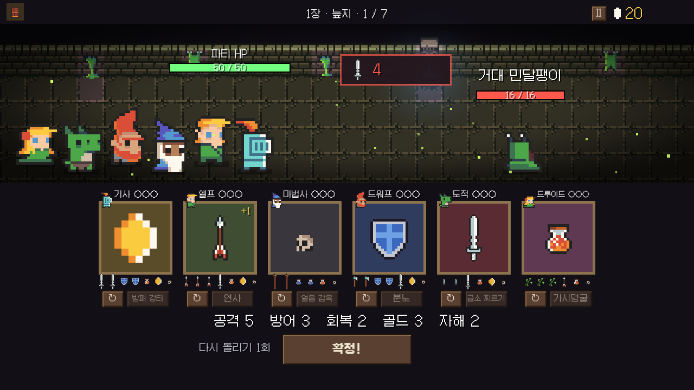
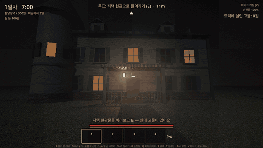
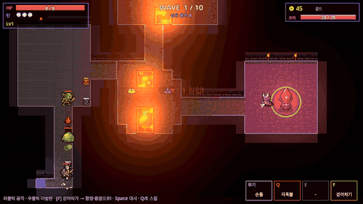
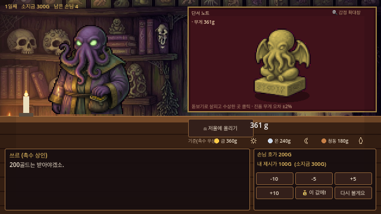
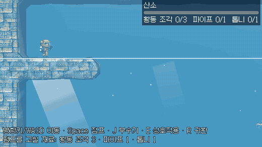

# GG

직접 만든 인디 게임 모음. 게임 하나 = 루트의 폴더 하나.

## 게임

| 화면 | 게임 | 장르 | 상태 |
|---|---|---|---|
|  | **[릴 던전](reel-dungeon/)** | 슬롯 덱빌딩 던전 로그라이크 — 동료 한 명이 릴 하나, 9명 중 골라 3장 돌파 (2D 픽셀, Unity) | 플레이 가능 (이어하기·어려움 0~5), 사람 플레이테스트 전 |
|  | **[유령집 이삿짐센터](haunted-movers/)** | 2~4인 온라인 협동 호러 — 귀신 들린 저택에서 고물 건지기 (1인칭 3D) | 플레이 가능, 플레이테스트 중 |
|  | **[마왕님은 바쁘다](demon-lord-is-busy/)** | 던전 디펜스 + 액션 로그라이크 (2D) | 플레이 가능, 플레이테스트 중 |
|  | **[저주받은 전당포](cursed-pawnshop/)** | 크툴루풍 감정·장사 시뮬, 28일 캠페인 (2D) | 완성 |
|  | **[가라앉은 도시](sunken-city/)** | 잠수 탐험 + 영역 재건 (2D 사이드뷰) | 보류 (M3 일부까지) |

게임마다 폴더 안 README에 스크린샷, 조작, 진행 상황이 있습니다.

## 플레이

**다운로드** — [Releases](https://github.com/saechimdaeki/GG/releases/latest)에서 `<게임>-mac.zip` / `<게임>-windows.exe` (릴 던전은 `ReelDungeon-windows.zip`, 풀어서 `ReelDungeon.exe`)

- Mac: zip을 풀면 `.app`. 서명이 없어서 처음엔 **우클릭 → 열기**
- Windows: SmartScreen이 뜨면 **추가 정보 → 실행**

**소스로 실행** (Godot 4.7.2)

```bash
cd haunted-movers           # 또는 다른 게임 폴더
godot --headless --import   # 클론 직후 한 번
godot
```

**릴 던전** (Unity 6000.6.9f1) — Unity Hub → Add → `reel-dungeon` 폴더로 열거나, 명령줄로 맥 빌드:

```bash
cd reel-dungeon
"/Applications/Unity/Hub/Editor/6000.6.9f1/Unity.app/Contents/MacOS/Unity" -batchmode -quit -projectPath "$PWD" -executeMethod BuildScript.BuildMac
open Builds/Mac/ReelDungeon.app
```

## 개발

- 릴 던전만 Unity 6000.6.9f1 (C#), 나머지는 Godot 4.7.2 (GDScript)
- 푸시마다 게임별 자동 테스트가 돕니다 (`.github/workflows/smoke.yml`). 릴 던전은 [GameCI](https://game.ci)로 EditMode 테스트를 돌립니다
- 태그를 푸시하면 모든 게임이 Mac·Windows로 빌드되어 (릴 던전은 GameCI `unity-builder`) 릴리스에 올라가고, 지난 태그 이후 `feat:`/`fix:` 커밋이 게임별 [패치노트 이슈](https://github.com/saechimdaeki/GG/issues?q=label%3Apatch-notes)로 등록됩니다 (`.github/workflows/release.yml`)

```bash
git tag v0.4.0 && git push origin v0.4.0
```

새 게임은 루트에 폴더 하나(엔진 프로젝트 통째로 + README)를 만들고, 위 표와 `smoke.yml`에 한 줄씩 추가합니다.

### 릴 던전 Unity CI와 배포

릴 던전 EditMode 테스트와 배포 빌드는 Unity가 활성화된 Apple Silicon 러너 `gg-release-mac`에서 실행합니다. Mac이 로그인 상태로 켜져 있어야 합니다. EditMode는 저장소 소유자의 내부 PR과 `main` 푸시에서 실행합니다. 배포 미리보기는 `reel-dungeon-preview-*` 태그로, 정식 릴리스는 `v*` 태그로 시작합니다.
