# 냥난리 · Cat Chaos

주인이 출근했습니다. 퇴근까지 10분. 고양이가 되어 집을 최대한 어지르세요. 컵을 툭 쳐서 떨어뜨리고, 화분을 엎고, 휴지를 굴려 풀고, 소파를 벅벅 긁으면 전부 점수입니다. 주인이 오기 직전 내 방석에 숨으면 시치미 보너스가 붙습니다.

## macOS 다운로드

[CatChaos-mac.zip 다운로드](https://github.com/saechimdaeki/GG/releases/download/cat-chaos-v0.1.0/CatChaos-mac.zip) · [릴리스 노트](https://github.com/saechimdaeki/GG/releases/tag/cat-chaos-v0.1.0)

Apple Silicon Mac(M1 이상)에서 압축을 풀고 `CatChaos.app`을 실행합니다. Gatekeeper가 실행을 차단하면 시스템 설정의 **개인정보 보호 및 보안**에서 **확인 없이 열기**를 선택합니다.

## 플레이 GIF

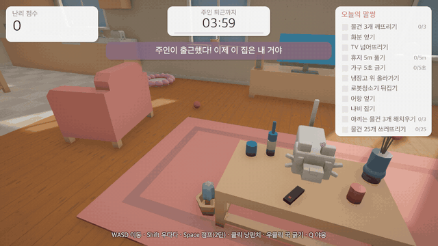

| | |
|---|---|
| **타이틀**<br>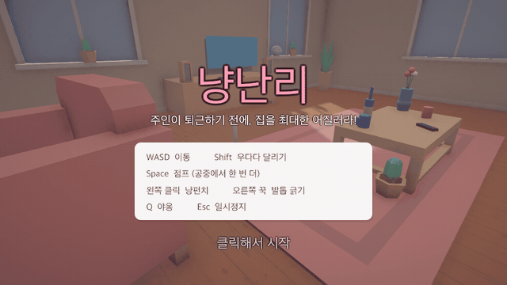 | **주인의 출근과 야옹**<br>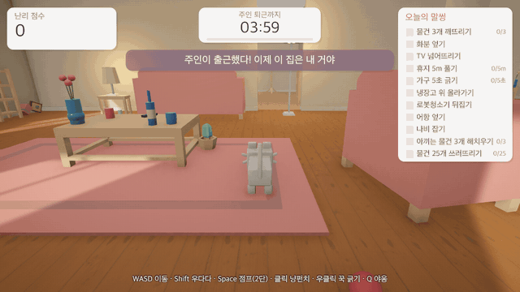 |
| **우다다와 2단 점프**<br>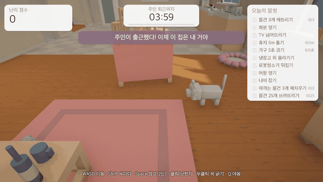 | **주방 조리대 탐색**<br>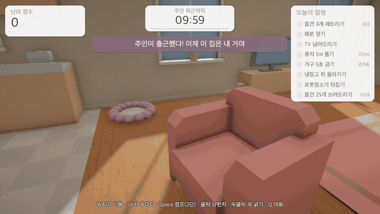 |
| **화분 엎기**<br>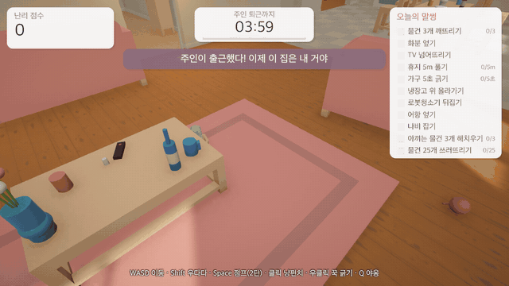 | **TV 떨어뜨리기**<br>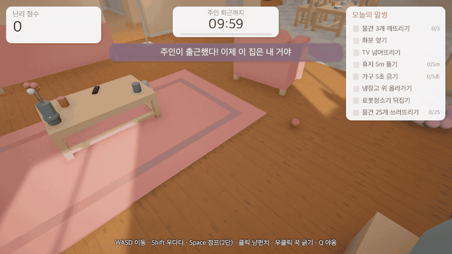 |
| **소파 긁기**<br>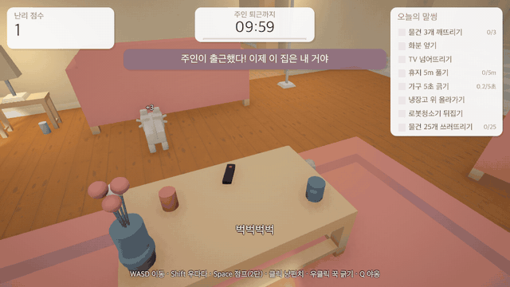 | **욕실에서 휴지 풀기**<br>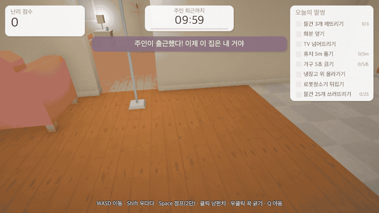 |
| **로봇청소기 출동**<br>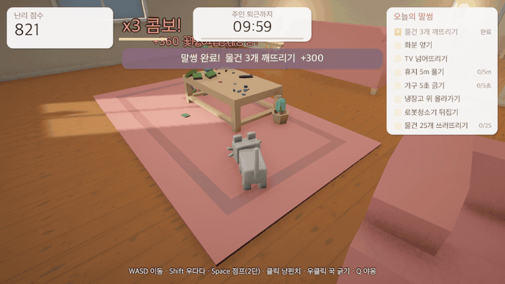 | **냥펀치로 청소기 뒤집기**<br>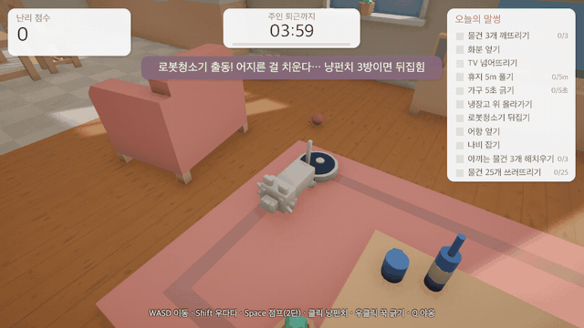 |
| **방석에서 시치미 떼기**<br>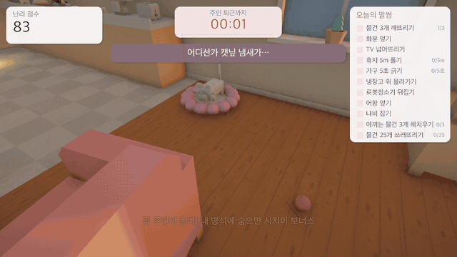 | **주인 귀가**<br>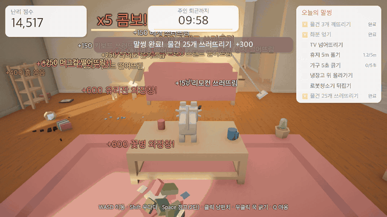 |
| **결과와 등급**<br>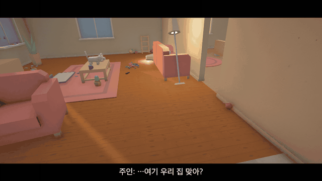 | |

## 빌런 · 로봇청소기

1분 15초가 지나면 주방 구석 충전대에서 로봇청소기가 출동하고, 이후 2분마다 또 나옵니다(동시에 최대 2대). 바닥에 떨어진 조각·흙·휴지 자국을 빨아들이고, 하나 치울 때마다 10점씩 깎입니다. 냥펀치 3방이면 뒤집혀 멈추고 500점을 줍니다.

## 조작

| 행동 | 키 |
|---|---|
| 이동 · 우다다 | WASD · Shift |
| 점프 (공중에서 한 번 더) | Space |
| 냥펀치 | 왼쪽 클릭 |
| 발톱 긁기 (소파·의자·침대) | 오른쪽 클릭 꾹 |
| 야옹 | Q |
| 일시정지 · 결과 화면에서 다시 하기 | Esc · R |

## 점수

사고를 2.5초 안에 이어 치면 콤보가 x5까지 오릅니다. 오른쪽 "오늘의 말썽" 목록을 채우면 300점씩 더 받습니다. 규칙과 수치는 [design/game-brief.md](design/game-brief.md), 실제 값은 `Assets/Resources/tuning.json`에 있습니다.

## 소스로 실행하고 GIF 캡처하기

Unity Hub에서 `cat-chaos/`를 Unity 6000.6.9f1로 열고 `Assets/Scenes/Main.unity`에서 Play를 누릅니다. 터미널에서 macOS 앱을 빌드하고 장면을 캡처할 수도 있습니다.

```bash
tools/shots.sh play chaos result
tools/gifs.sh                  # FFmpeg 필요
tools/gifs.sh chaos robot      # 장면 지정
tools/package-mac.sh           # Builds/Release/CatChaos-mac.zip 생성
```

Unity 6000.6.9f1로 셋업과 macOS 빌드를 한 뒤 장면별 스크린샷을 `production/qa/evidence/`에 저장합니다. 빌드된 게임은 `Builds/Mac/CatChaos.app`입니다. `tools/gifs.sh`는 빌드에 내장된 장면 재생 기능으로 `docs/media/`에 GIF를 저장합니다.

## 에셋 출처 (모두 CC0)

- 고양이: Quaternius "Cat" (Cube World Kit), poly.pizza
- 가구: Kenney "Furniture Kit", kenney.nl
- 바닥·벽 텍스처, 택배 상자·바구니·쓰레기봉투: Poly Haven
- 로봇청소기: 도형 조합
- 소리: 코드로 합성 (`Assets/Scripts/Sfx.cs`)
