# 저주받은 전당포

안개 낀 마계 항구의 뒷골목 전당포를 물려받아, 괴물 손님들과 말싸움하고 수상한 물건을 감정·흥정하며 28일 동안 고리대금업자 바알의 빚 3,000골드를 갚는 감정·장사 시뮬레이션. 손님들은 내 행동을 기억한다.

- 기획서: [`design/game-brief.md`](design/game-brief.md) · 스토리 설정집: [`design/story.md`](design/story.md)
- 작업 기록: [`production/epics/cursed-pawnshop/EPIC.md`](production/epics/cursed-pawnshop/EPIC.md)
- 아트 프롬프트: [`art/PROMPTS.md`](art/PROMPTS.md)

<p align="center">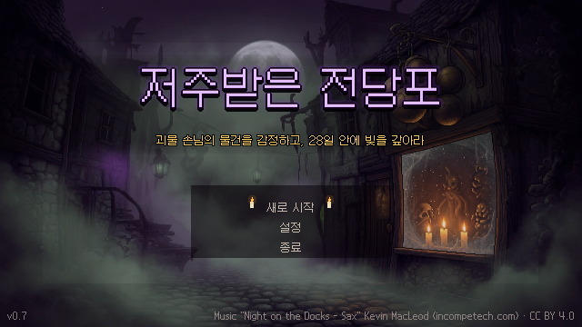<br><sub>타이틀</sub></p>

## 이런 게임

- **감정** — 돋보기로 흠집·각인을 찾고, 저울로 무게를 재고, 촛불로 저주를 비춰 진품·가짜·저주품을 가려내기
- **흥정** — 질문하고 추궁하고 값을 부르기. 손님은 내 행동을 기억한다
- **장사와 빚** — 산 물건을 진열해 팔고, 매주 고리대금업자 바알에게 빚을 갚기
- **28일 이야기** — 사라진 전 주인 모로의 행방과 여러 엔딩

## 플레이 화면

**시작**

| | | |
|---|---|---|
| 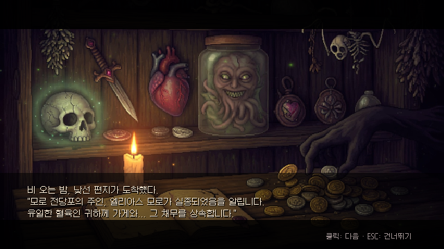 | 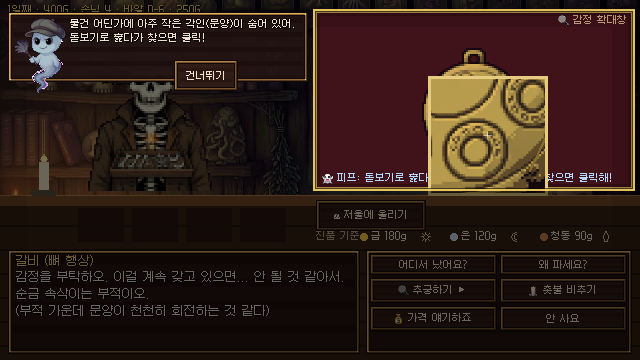 | 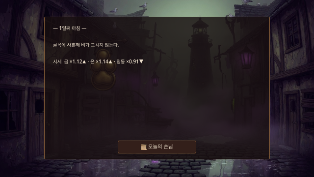 |
| 비 오는 밤, 낯선 편지 | 튜토리얼 — 첫 물건 | 전당포의 아침 |

**감정과 흥정**

| | | |
|---|---|---|
| 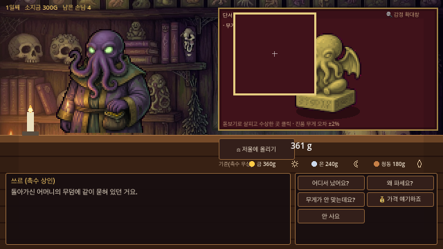 | 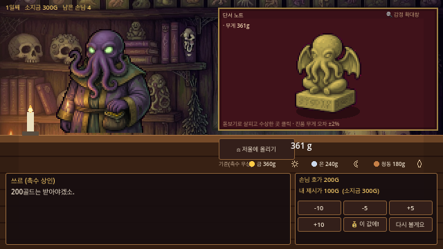 | 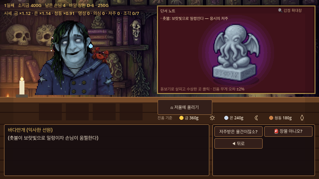 |
| 손님과 대화 | 무게를 재고 값을 부르기 | 촛불로 저주 비추기 |

**장사와 이야기**

| | | |
|---|---|---|
| 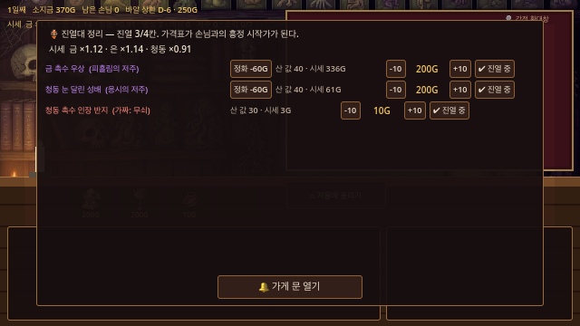 | 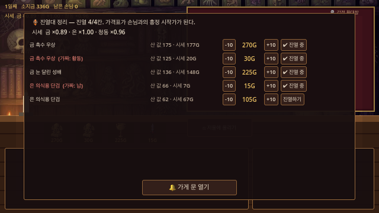 | 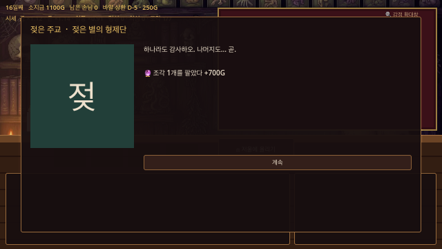 |
| 저주 걸린 손님 | 진열대와 시세 | 이야기 선택 |

**빚과 결말**

| | | |
|---|---|---|
| 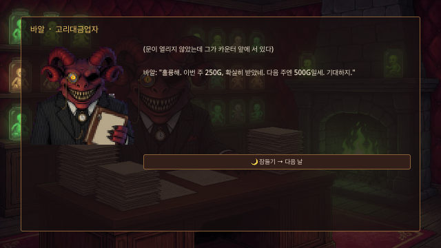 | 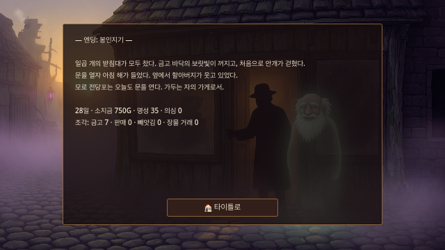 | 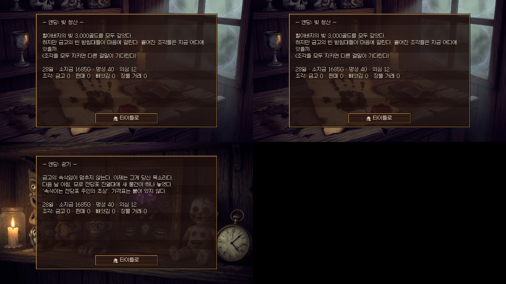 |
| 고리대금업자 바알 | 엔딩 | 여러 엔딩 |

**손님들**

| | | |
|---|---|---|
| 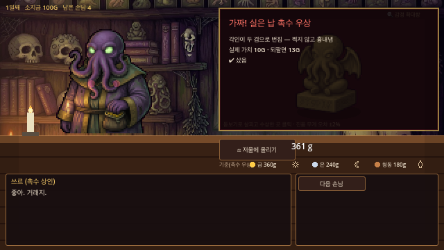 | 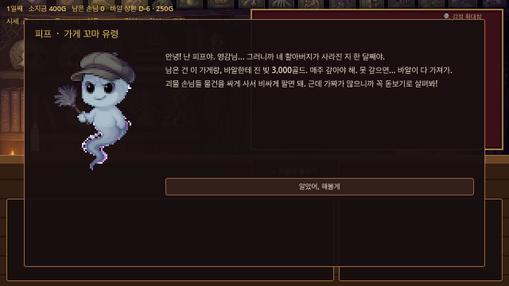 | 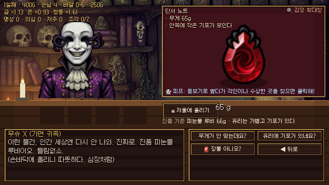 |
| 가짜 납 촉수 우상 — 감정 결과 | 가게 꼬마 유령 피프 | 보석일까 유리일까 — 기포를 찾아라 |

**컷신**

| | | |
|---|---|---|
| 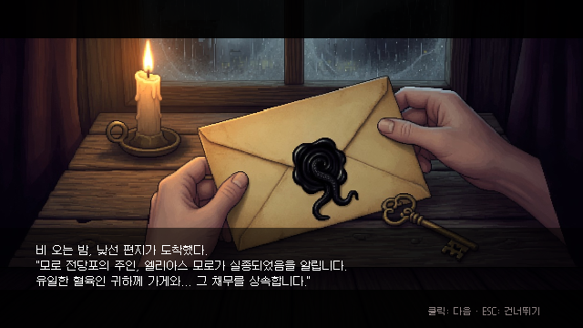 | 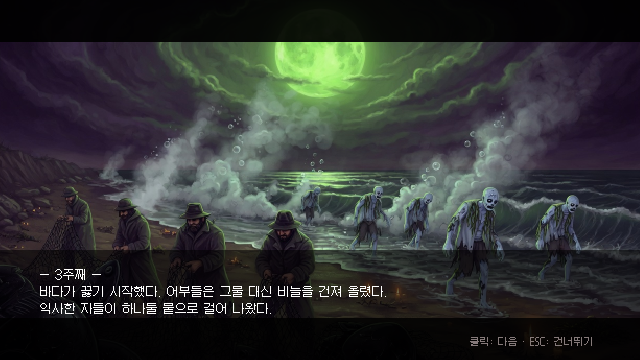 | 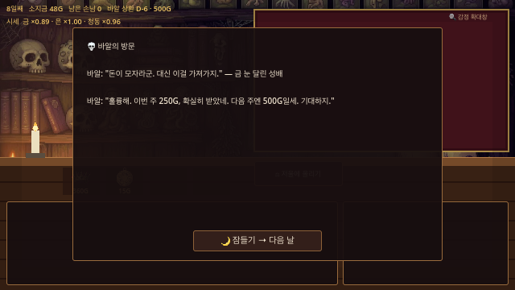 |
| 비 오는 밤 도착한 낯선 편지 | 3주째 — 바다가 끓기 시작한다 | 빚쟁이 악마 바알의 방문 |

## 실행 (Godot 4.7.2 필요)

```bash
cd cursed-pawnshop
godot --headless --import   # 클론 직후 한 번
godot
```

조작: 물건 위에 마우스 → 돋보기, 수상한 곳 클릭 → 단서 노트, 저울 버튼 → 무게, 🕯 촛불 → 저주. 오른쪽 아래 선택지로 질문·추궁·흥정. ESC → 일시정지·설정.
디버그용 고정 시드: `godot -- --seed=36`

**실행 파일** (export 템플릿 필요, 자세한 건 [루트 README](../README.md#실행)):

```bash
godot --headless --export-release "macOS" build/macos/CursedPawnshop.zip
godot --headless --export-release "Windows" build/windows/CursedPawnshop.exe
```

## 어디까지 했나 (2026-10-30)

| 마일스톤 | 내용 | 상태 |
|---|---|---|
| M1 하루 순환 | 아침 소식 → 손님 대화·감정·추궁·흥정 → 밤 정산. 손님 명부가 원한/호감을 기억해 복수·선물 이벤트 | ✅ |
| M2 장사 | 창고·진열대·가격표, 사는 손님과 흥정, 매일 바뀌는 금·은·청동 시세(소식이 움직임), 밤 도매상 | ✅ |
| M3 빚과 성장 | 바알 주간 상환(250/500/900/1350), 압류·이자·차압, 밤의 상점 업그레이드 6종(진열대·정밀 저울·확대경·시금석·경비 고블린·간판) | ✅ |
| M4 이야기 | 28일 스토리 장면 20개(NPC 10명), 흐르그의 조각 7개, 명성·의심·장물·경비대 단속, 백작 후원, 엔딩 6종 | ✅ |
| M5 저주 | 저주품(촛불로만 보임)·저주 수집가(2.5배)·밤의 저주 사건 4종·저주 게이지·정화·광기 엔딩 | ✅ |
| M6 완성 | 타이틀(그림)·아침 자동 저장/이어하기·효과음 12종+빗소리·배경 음악 3곡·피프 팁·엔딩 컷 7장·장면 배경 6장 | ✅ |

**콘텐츠 현황**
- 손님 24종 (전부 도트 초상화), 손님 명부 18명, 성격 4종(정직·급함·깐깐함·사기꾼)
- 물건 27종 (전부 도트 그림): 금속 15종(금·은·청동 / 가짜: 황동·주석·납·무쇠) + 보석 3(천연/유리) + 유기물 5(진품/밀랍) + 문서 4(원본/위조)
- 흐르그의 조각 7개 그림(조각을 얻을 때 표시), 장면 배경 6장(아침 골목·밤 가게·바알 사무실·지하 금고·항구·의식), 엔딩 컷 7장
- NPC 10명 초상화, 가게 배경·타이틀 그림
- 단서: 각인(다른 문양·번짐), 무게, 도금 벗겨짐 / 유리 기포 / 밀랍 이음새 / 잉크 번짐, 시금석, 장물, 촛불(저주)
- 엔딩 7종: 봉인지기·각성·장물왕·최고 감정사·빚 청산·차압·광기

**검증**
- CI: 푸시마다 `tests/smoke/run_check.gd` (모든 물건 생성 + 28일 두 판)
- 28일 봇 시뮬레이션: 잘하는 플레이는 5판 중 4판 빚 청산, 대충 산 플레이는 차압. 스토리 3경로(조각 지킴/판매/쥐왕) 모두 엔딩 도달
- 화면 증거: `production/qa/evidence/story-00N-*/`
- **사람 플레이테스트는 아직** — 밸런스(흥정 수치·빚 금액)는 첫 평가 후 조정 예정

**아트**: 묶음 1~6 전부 완료(GPT/Grok) — 초상화 34, 물건 34, 배경·엔딩·컷신 32. 프롬프트는 `art/PROMPTS.md`.

**음악**: 타이틀·아침 / 낮 영업 / 밤·바알 세 곡 + 합성 빗소리 레이어. 곡 바꾸려면 `assets/audio/music_title|music_day|music_night` 를 같은 이름의 .ogg/.mp3/.wav로 교체.

## 크레딧

- 글꼴 갈무리(Galmuri) — quiple, SIL Open Font License 1.1 (`assets/fonts/Galmuri-OFL.txt`)

- 음악 "Night on the Docks - Sax" — Kevin MacLeod (incompetech.com), Licensed under Creative Commons: By Attribution 4.0 — https://creativecommons.org/licenses/by/4.0/
- 음악 "I swear I saw it" — yd (OpenGameArt.org), CC0
- 음악 "Post Apocalyptic Wastelands [Loop Ready]" — Juhani Junkala / SubspaceAudio (OpenGameArt.org), CC0
- 효과음·빗소리 — `tools/gen_audio.py` 로 합성
- 그림 — GPT / Grok 생성 원본(`art/raw/`)을 `tools/sprite_convert.py` 로 도트화

## 아트 넣기

1. `art/PROMPTS.md` 프롬프트로 이미지 생성 (마젠타 배경) → `art/raw/portraits/`, `art/raw/items/`, `art/raw/scenes/`
2. 변환:
   ```bash
   python3 tools/sprite_convert.py art/raw/portraits assets/sprites/portraits 75
   python3 tools/sprite_convert.py art/raw/items assets/sprites/items 58
   python3 tools/sprite_convert.py art/raw/scenes assets/sprites/scenes scene
   godot --headless --import
   ```
   없는 그림은 코드 그림이 대신 그려짐.
