# 잔류신호 · Residual Signal

폐역에 남은 구조 요청에 응답하는 1인칭 협동 FPS. 해림역 캠페인 〈열한 번째 이름〉에서 전력을 복구하고 생존자를 구조해 화물 연결로로 탈출합니다. 혼자서는 AI 동료 셋과 4개 작전을 플레이할 수 있고, 온라인 캠페인은 최대 4명이 방 코드로 참가합니다.

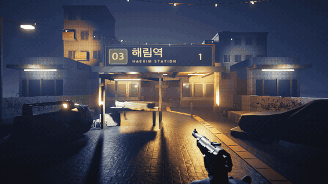

## 이번 업데이트

- 해림역 광장을 배경으로 움직이는 시작 화면에서 작전과 난이도를 고르고, 온라인 방을 만들거나 코드로 참가합니다.
- 게움이는 산성 웅덩이로 이동로를 막고, 들소와 목말꾼은 분대원을 붙잡아 대열을 흐트러뜨립니다.
- 근접 무기 4종, 파이프 폭탄·화염병, 진통제·아드레날린을 역 곳곳에서 주울 수 있습니다. 경보 차량을 건드리면 감염체 무리가 몰려옵니다.
- 보통 난이도의 받는 피해와 무리 규모를 낮추고, 캠페인의 흐느끼는 자를 승강장에서 정비동으로 옮겼습니다.

| 출격 화면 | 온라인 협동 |
|---|---|
| 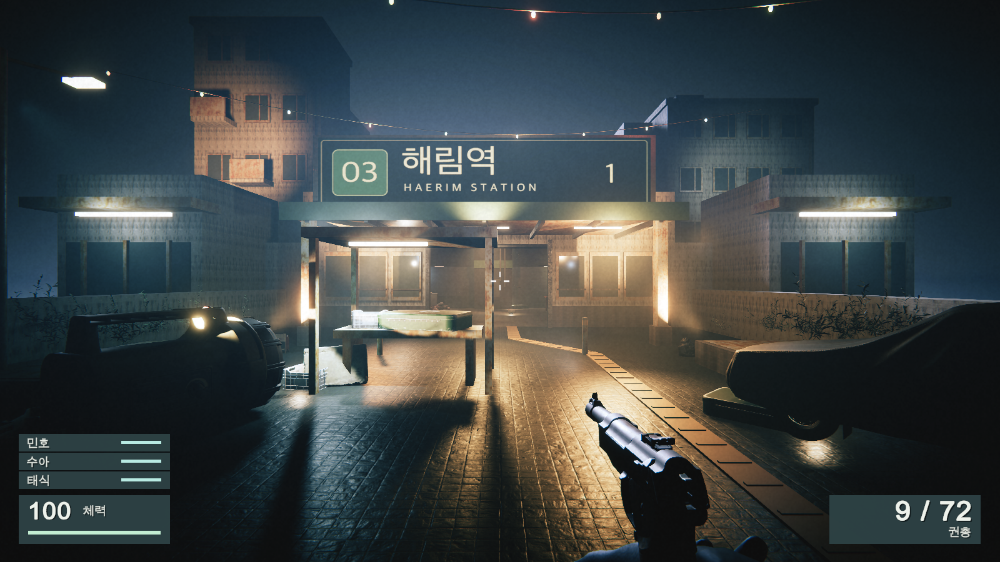 | 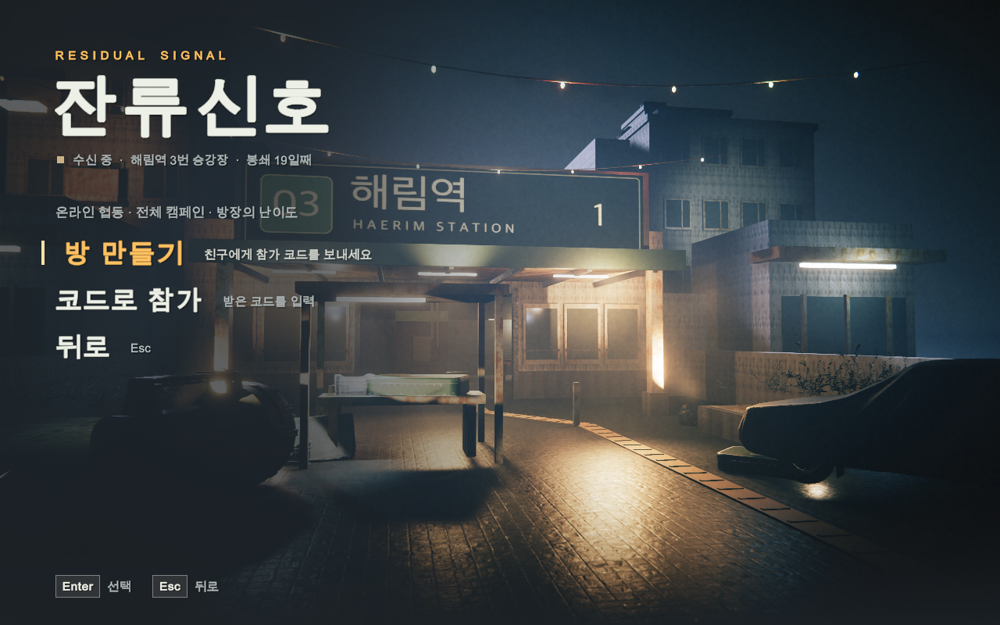 |

## 플레이

GitHub Releases에서 제목이 **잔류신호 macOS 플레이테스트**인 릴리스를 열고 `ResidualSignal-mac.zip`을 받아 압축을 푼 뒤 `Residual Signal.app`을 실행하세요. [GitHub Releases](https://github.com/saechimdaeki/GG/releases)

### Unity에서 실행

1. Unity Hub에서 이 저장소의 `dead-frequency` 폴더를 프로젝트로 추가합니다.
2. **Unity 6000.6.9f1**으로 열고 패키지와 에셋 임포트가 끝날 때까지 기다립니다.
3. `Assets/Scenes/Platform03.unity`를 열고 **Play**를 누릅니다.
4. **혼자 출격** 또는 **온라인 협동**을 선택합니다. 시작 화면 뒤로 실제 역 앞 광장이 천천히 움직이고, 작전(미션)은 `<` `>` 또는 ←→, 난이도는 네 칸 중 하나를 바로 눌러 고릅니다([시작 화면](production/qa/evidence/start-screen-2026-11-25.png)). 온라인은 한 사람이 방을 만들고, 다른 플레이어가 **코드로 참가**에서 방 코드를 입력합니다.

온라인 방은 Unity Gaming Services Relay에 연결합니다. 포크에서 자체 서비스 구성을 사용하려면 Unity 프로젝트를 본인의 Cloud 프로젝트에 연결하세요.

### macOS 앱 빌드

저장소 루트에서 실행하세요. Unity Hub를 기본 위치에 설치한 경우 아래 명령으로 로컬 실행 앱을 만들 수 있습니다.

```zsh
cd dead-frequency
UNITY="/Applications/Unity/Hub/Editor/6000.6.9f1/Unity.app/Contents/MacOS/Unity"
"$UNITY" -batchmode -quit -projectPath "$PWD" \
  -executeMethod ResidualSignal.StationTrialBuild.Mac \
  -trialOutput "$PWD/Builds/Residual Signal Playtest.app"
open "Builds/Residual Signal Playtest.app"
```

| 조작 | 동작 |
|---|---|
| WASD / 마우스 | 이동 / 시점 |
| 왼쪽 클릭 / 오른쪽 클릭 또는 왼쪽 Alt(길게) | 사격 / 정조준 |
| V 또는 휠 클릭 | 개머리판 밀치기 |
| E / E 길게 | 상호작용 / 쓰러진 동료 일으키기 |
| Q | 조준한 감염체에 분대 집중 사격 지시 (혼자 출격) |
| R / F | 재장전 / 손전등 |
| G 또는 3 | 투척 무기 던지기 (파이프 폭탄 / 화염병) |
| 4 | 진통제 먹기 / 아드레날린 주사 |
| 1 / 2 / 휠 | 주무기 / 권총 또는 근접 무기 / 무기 전환 |
| Esc / 클릭 | 마우스 잠금 해제 / 조작 재개 |

## 미션과 난이도

시작 화면에서 **미션**과 **난이도** 버튼을 눌러 바꿉니다. 온라인 협동은 항상 전체 캠페인이며, 방장의 난이도를 따릅니다.

| 미션 | 내용 |
|---|---|
| 열한 번째 이름 | 광장부터 화물 연결로 탈출까지 전체 캠페인 |
| 정비동 돌파 | 승강기 앞에서 서이경과 함께 시작해 정비동·적재장 거대체·화물 연결로를 돌파 |
| 승강장 사수 | 셔터가 열리지 않는 생존 모드. 시간이 갈수록 무리가 빨라지고 3분마다 거대체가 옴. 동 4분 · 은 7분 · 금 10분 |
| 연료 수집 | 역 곳곳의 연료통 8개를 단말기 옆 비상 발전기로 옮겨 붓기. 90초에서 시작해 통마다 +20초. 운반 중엔 사격 불가, 이동 20% 감속 |

| 난이도 | 받는 피해 | 감염체 체력 | 무리 규모 | AI 동료 화력 |
|---|---|---|---|---|
| 쉬움 | ×1.0 | ×1.0 | ×1.0 | ×1.0 |
| 보통 (기본) | ×1.1 | ×1.05 | ×1.1 | ×0.95 |
| 고급 | ×1.6 | ×1.3 | ×1.45 | ×0.75 |
| 전문가 | ×2.4 | ×1.6 | ×1.9 | ×0.55 |

보통에서는 쉬움과 같은 공격 간격과 부활 체력을 유지합니다. 고급부터는 감염체 공격과 디렉터의 무리 투입 간격이 더 짧아지고, 일어났을 때 회복하는 체력도 줄어듭니다.

**흐느끼는 자** — L4D2의 위치(Witch)처럼 바닥에 웅크려 흐느끼는 감염체가 캠페인·정비동 돌파·연료 수집에 하나씩 있습니다(캠페인은 정비동. 승강장에 있을 때는 비상전력 단말기에서 손전등이 닿아 매번 깨어났음). 총소리에는 반응하지 않지만, 가까이 가거나 손전등을 비추거나 쏘면 깨어나 달려들고 한 번에 큰 피해를 줍니다. 손전등(F)을 끄고 돌아가세요.

### 신규 특수 감염체

| 이름 | L4D2 대응 | 하는 일 | 대처 |
|---|---|---|---|
| 게움이 | 스피터 | 5~17m 밖에서 산성액을 뱉어 반경 2.4m 웅덩이를 7초간 남김. 오래 서 있을수록 피해가 커짐 | 바로 웅덩이 밖으로. AI 동료도 피함 |
| 들소 | 차저 | 한쪽 팔이 부푼 덩치(체력 420). 0.65초 예비 동작 뒤 돌진해 한 명을 벽까지 들고 가 바닥에 내리찍음. 길목의 다른 생존자는 튕겨 냄 | 스스로는 못 빠져나옴. 동료가 죽여야 풀림 |
| 목말꾼 | 자키 | 작고 빠름(체력 250). 생존자 어깨에 올라타 분대 반대쪽으로 끌고 감 | 동료가 쏘거나 밀쳐서 떼어 냄 |

디렉터의 특수 감염체 순서는 덮치개 → 게움이 → 끌개 → 들소 → 울음꾼 → 목말꾼 → 부풀이입니다. 붙잡힌 AI 동료도 이제 플레이어처럼 붙잡힌 동안 피해를 입습니다.

### 바닥 장비

탄약 상자와 구급상자 옆에 장비가 놓여 있고, 위에 희미한 조명이 있어 어둠 속에서도 보입니다. E로 줍고, 칸마다 하나만 들 수 있으며 바꾸면 들던 것을 그 자리에 내려놓습니다.

| 칸 | 장비 | 효과 |
|---|---|---|
| 근접 (2) | 소방 도끼 · 쇠지렛대 · 야구 방망이 · 마체테 | 권총 자리를 대신함. 한 번에 일반 감염체를 쓰러뜨리고 2~4마리를 함께 벰. 거대체에는 1/4 |
| 투척 (G) | 파이프 폭탄 · 화염병 | 아래 참고 |
| 약 (4) | 진통제 | 임시 체력 +50 |
| 약 (4) | 아드레날린 | 임시 체력 +25, 15초간 이동 25%·휘두르기·일으키기 빨라짐 |

임시 체력은 체력 막대 뒤에 흰 칸으로 보이고, 초당 0.27씩 줄어들며, 맞으면 먼저 깎입니다(L4D2와 같음).

**자동차 경보** — 역 앞 봉쇄선과 화물 연결로의 덮개 씌운 차에는 경보가 걸려 있습니다(덮개 위에서 붉은빛이 깜빡임). 쏘거나, 근접 무기로 치거나, 옆에서 파이프 폭탄이 터지면 22초간 사이렌과 비상등이 켜지고 양쪽 시야 밖에서 무리가 몰려옵니다.

**투척 무기** — 탄약 상자 옆에 파이프 폭탄과 화염병이 번갈아 놓여 있습니다. 파이프 폭탄은 6초 동안 삑삑거리며 26m 안의 일반 감염체를 끌어모은 뒤 반경 6.5m를 날려 버립니다(거대체·흐느끼는 자는 25%만). 화염병은 닿은 자리에 반경 3.4m 불바다를 9초간 깔고, 보통 이상에서는 불 위에 선 생존자도 오인사격 비율만큼 탑니다. 바닥의 투척 무기 위에는 희미한 조명이 있어 어둠 속에서도 찾을 수 있습니다. 온라인 협동에서는 누가 던져도 모든 참가자 화면에 같은 투척이 보이고, 피해와 유인은 방장 쪽에서 계산합니다.

**L4D2 규칙** — 두 번 쓰러졌다 일어나면 화면이 흑백이 되고, 구급상자(직접 쓰거나 동료가 감아 줌) 없이 한 번 더 쓰러지면 사망합니다. 보통 이상에서는 아군 오인사격 피해가 들어갑니다(보통 10%, 고급 30%, 전문가 60%). 승강장 사수·연료 수집의 보급함은 25초마다 탄약이 다시 찹니다.

화면은 Left 4 Dead 2풍으로 채도를 낮추고 대비·필름 그레인·비네트·안개를 강화했으며, 손전등이 감염체 그림자를 벽에 드리웁니다.

## 〈열한 번째 이름〉

광장 대피 통제소를 지나 비상전화에 응답합니다. 명부를 확인한 뒤 침수 통로 또는 직원 통로를 열고, 승강장 전력을 복구해 셔터가 열릴 때까지 버팁니다. 서이경을 구조한 뒤 정비동 유압 펌프를 가동하고, 적재장 거대체를 제압한 뒤 화물 연결로에서 배전함과 서비스문 잠금을 조작하고 서이경과 탈출합니다. 길은 바닥 유도선과 조명, 공간 배치로 안내합니다.

- **분대** — Mixamo 캐릭터를 적용한 AI 동료 셋이 보급품을 챙기고, 엄폐하며 접근하고, 지정한 표적에 집중 사격합니다. 쓰러진 아군을 일으키고 붙잡힌 아군을 우선 구조합니다.
- **전투** — 권총, 산탄총, 자동소총, 저격소총, 반자동 카빈. 정조준, 시점 반동, 총구 섬광, 탄흔, 부위별 피격 반응과 사망 물리 모션을 적용했습니다.
- **감염체** — 일반 감염체와 덮치개·끌개·부풀이·울음꾼·게움이·들소·목말꾼, 적재장 거대체. 새 세 종은 기존 시민 모델에 체형·색·자세를 달리해 구분합니다. 울음꾼의 호출은 공격으로 끊을 수 있습니다. 거대체는 콘크리트를 던지고, 돌진하거나 가까운 대상을 휩씁니다.
- **습격 연출** — 승강장은 준비 시간이 끝나면 시야 밖 통로에서 감염체 무리와 특수 감염체가 진입합니다. 이동 구간에서는 분대가 받는 압박에 따라 디렉터가 추가 무리와 휴식 간격을 조절합니다.
- **해림역** — 광장의 야간 조명, 대합실과 승강장의 배관·간판·등기구, 역 타일과 젖은 바닥, 정비동의 가구와 소품을 갱신했습니다.

## 플레이 장면

### 장비와 경보

| 파이프 폭탄 | 화염병 |
|---|---|
| 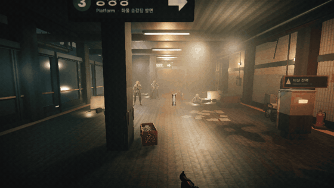 | 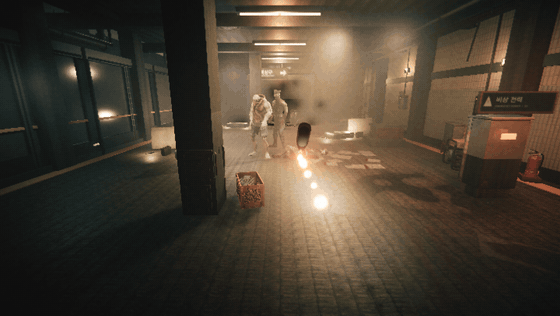 |

| 소방 도끼 | 차량 경보 |
|---|---|
| 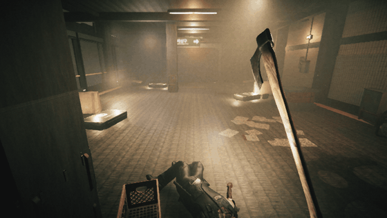 | 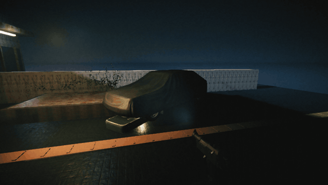 |

[파이프 폭탄](production/qa/evidence/pipe-bomb-pickup-2026-11-25.png) · [화염병](production/qa/evidence/molotov-pickup-2026-11-25.png) · [쇠지렛대](production/qa/evidence/pickup-Crowbar-2026-11-25.png) · [야구 방망이](production/qa/evidence/pickup-Bat-2026-11-25.png) · [마체테](production/qa/evidence/pickup-Machete-2026-11-25.png) · [진통제](production/qa/evidence/pickup-Pills-2026-11-25.png) · [아드레날린](production/qa/evidence/pickup-Adrenaline-2026-11-25.png)

### 특수 감염체

| 게움이 | 들소 | 목말꾼 |
|---|---|---|
| 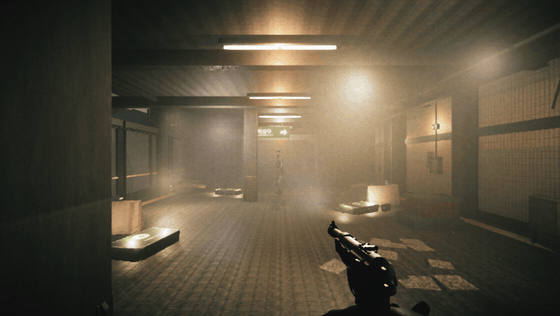 | 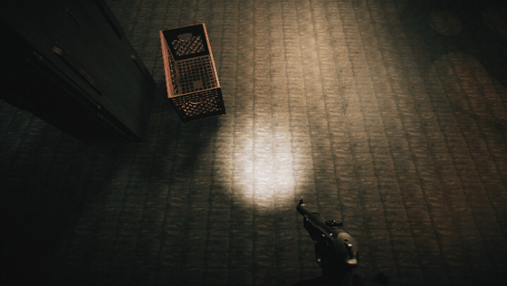 | 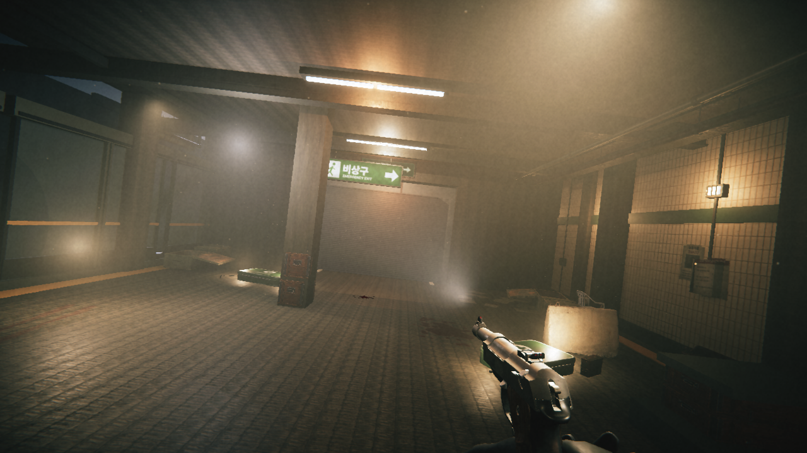 |

### 승강장 사수 (고급)

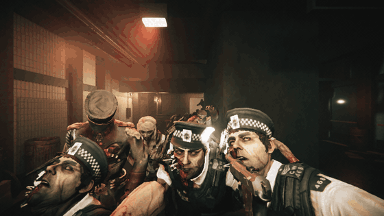

### 연료 수집

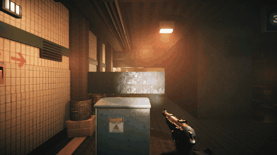

### 흐느끼는 자

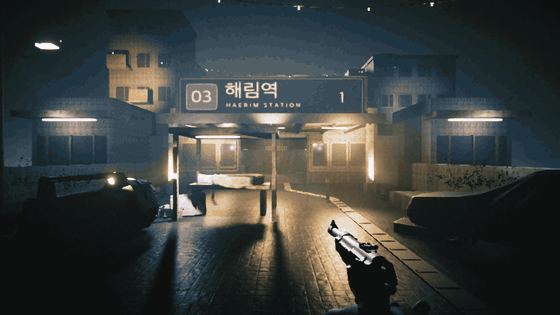

### 승강장 방어

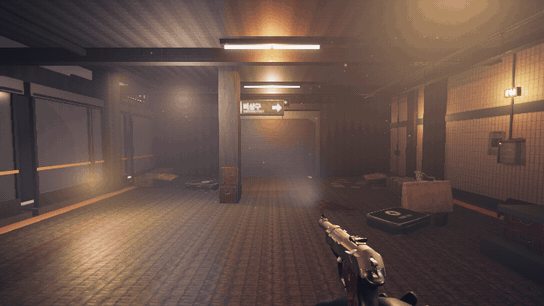

### 적재장 거대체

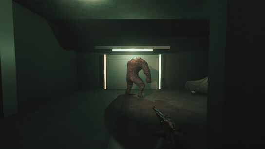

### 화물 연결로 탈출

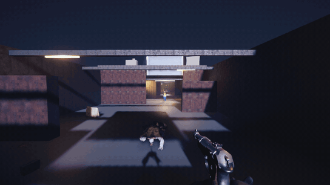

GIF는 Unity Play Mode에서 자동 조작으로 촬영했습니다. 신규 장비와 특수 감염체는 각각의 동작이 보이도록 별도 검사 장면에서 촬영했습니다.

스크린샷은 [AI 동료](docs/loading-bay-team.png), [해림역 내부](production/qa/evidence/architecture-detail-2026-11-24.png), [승강장](docs/media/platform-defense.png), [정비동](docs/loading-bay-workshop.png), [거대체](docs/loading-bay-boss.png), [화물 연결로](docs/media/freight-escape.png)에서 볼 수 있습니다.

## 검증과 남은 작업

| 검사 | 확인 항목 |
|---|---|
| `-throwCheck` | 파이프 폭탄 줍기·투척, 일반 감염체 4/4 유인·처치, 화염병 3/3 처치 |
| `-gearCheck` | 장비 8종 배치, 임시 체력 피해 흡수, 아드레날린, 소방 도끼 처치 |
| `-mutantCheck` | 산성액 피해, 들소의 운반·내리찍기, 목말꾼의 이동 방해, 특수 감염체 처치 후 포획 해제 |
| `-alarmCheck` | 사격으로 차량 경보가 울리고 감염체 무리 진입 |

기존 로컬 검사에서는 macOS 실행, 직원·침수 통로 양쪽 완주, 분대 전투와 표적 지시, 미션 4종, 흑백·오인사격·탄약 재충전을 확인했습니다. 이전 빌드의 Relay 방 생성·코드 참가와 로컬 2인 상태 동기화도 확인했습니다.

확장된 캠페인의 4인 Relay 완주, 신규 전투 기능의 온라인 동기화, 실제 플레이에 따른 밸런스·프레임 타임 검증이 남아 있습니다. 후속 캠페인과 약탈자 교전은 기획 단계입니다.

[게임 기획](design/game-brief.md) · [아트·오디오 출처 및 라이선스](docs/art-sources.md)
