# 마왕님은 바쁘다

던전을 짓고, 몬스터를 키우고, 용사가 쳐들어오면 마왕이 직접 나가서 걷어차는 2D 로그라이크.
함정 콤보(스프링으로 용사를 용암에 날리기, 기름+불 폭발)와 마왕 걷어차기가 핵심 재미.

- 엔진: **Godot 4.7.2** (GDScript), macOS에서 개발
- 기획서: [`design/game-brief.md`](design/game-brief.md) · 진행 로그: [`production/session-state/active.md`](production/session-state/active.md)

<p align="center">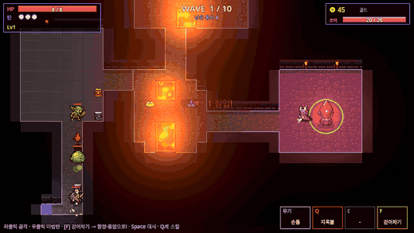<br><sub>용사 침공 — 함정 콤보와 마왕 걷어차기, 웨이브 보상 카드</sub></p>

## 이런 게임

- **짓기 → 막기** — 벽·가시·스프링·기름·화염 함정과 고블린·슬라임·해골궁수를 배치, 철문으로 용사 경로를 비틀기
- **마왕 직접 출격** — 근접·마법탄·대시·스킬, F로 용사를 용암·함정·벽에 걷어차기
- **콤보** — 용암 다이브, 기름 폭발, 벽꽝, 볼링. 3초 안에 이으면 COMBO xN
- **로그라이크** — 웨이브마다 규칙을 바꾸는 보상 카드, 영혼석으로 영구 강화, 지역 3종

## 플레이 화면

**짓기**

| | | |
|---|---|---|
| 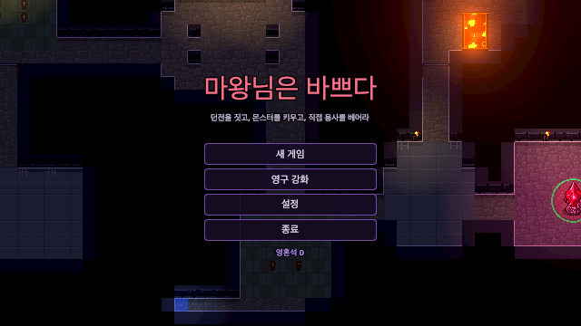 | 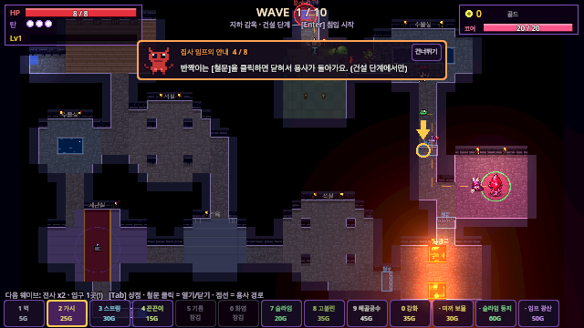 | 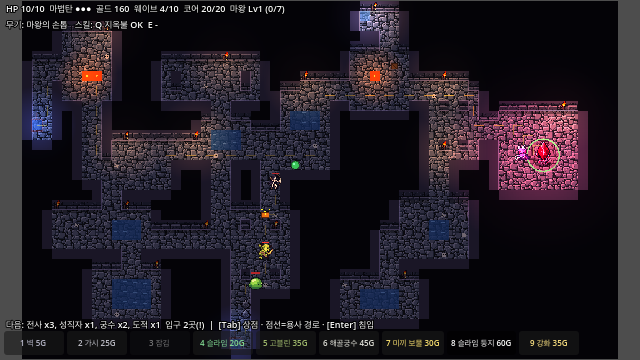 |
| 타이틀 | 집사 임프의 튜토리얼 | 함정과 몬스터 배치 |

**침공**

| | | |
|---|---|---|
| 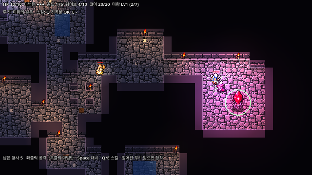 | 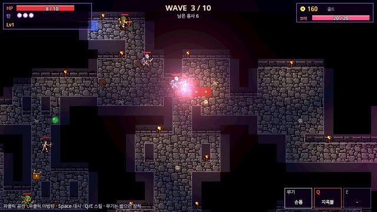 | 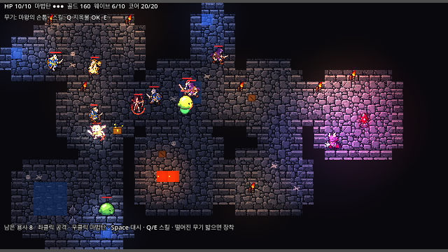 |
| 용사 침공 — 코어를 지켜라 | 마왕 출격 | 후반 웨이브 |

**지역**

| | | |
|---|---|---|
| 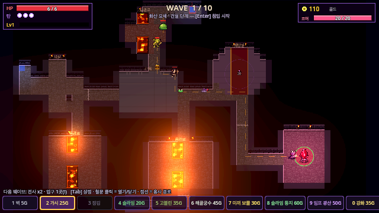 | 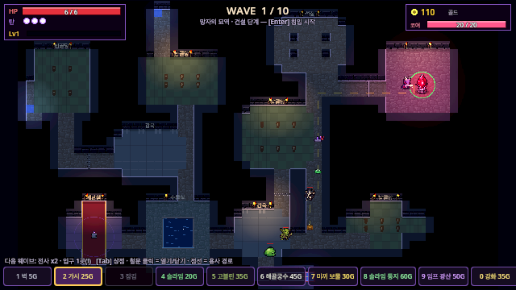 | 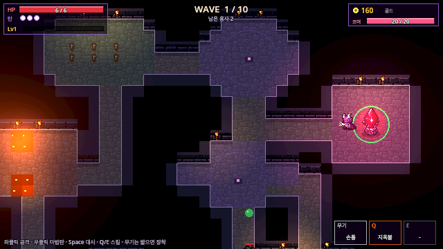 |
| 화산 요새 | 망자의 묘역 | 지하 감옥 |

**성장**

| | | |
|---|---|---|
| 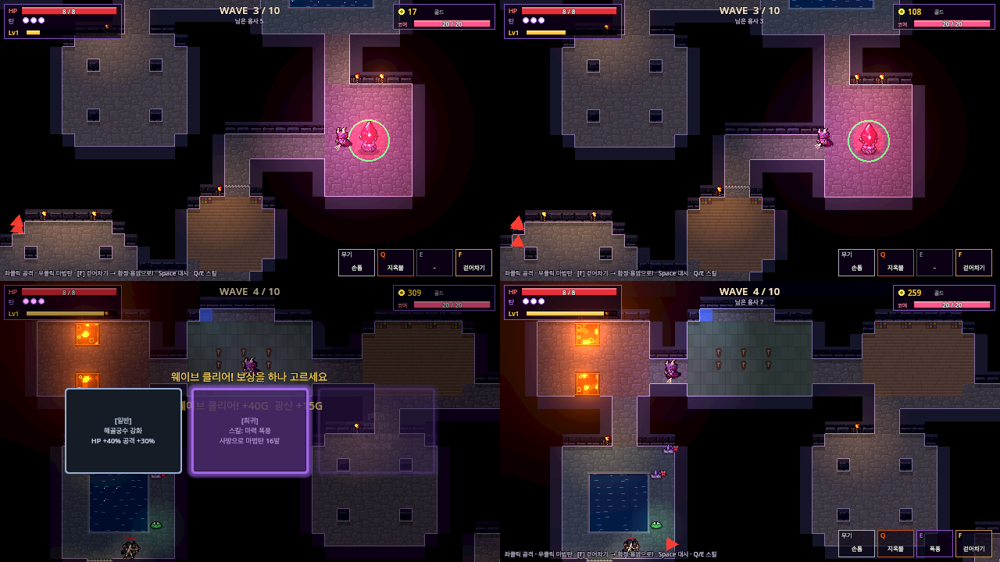 | 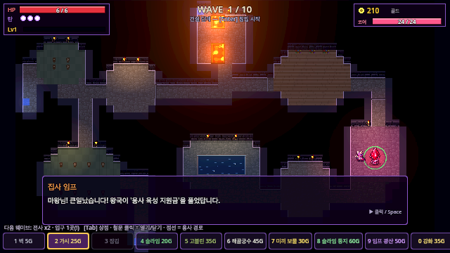 | 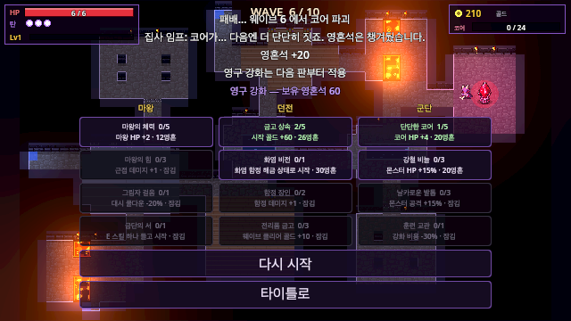 |
| 웨이브 보상 카드 | 이야기 — 집사 임프 | 영구 강화 트리 |

## 실행

Godot 4.7.2 가 `godot` 명령으로 잡혀 있어야 함 (`godot --version` → `4.7.2.stable`).

```bash
cd demon-lord-is-busy
godot --headless --import   # 처음 한 번 (클론 직후)
godot                       # 게임 실행 (타이틀 화면부터)
```

실행 파일 (export 템플릿 필요, 자세한 건 [루트 README](../README.md#실행)):

```bash
godot --headless --export-release "macOS" build/macos/DemonLordIsBusy.zip
godot --headless --export-release "Windows" build/windows/DemonLordIsBusy.exe
```

튜토리얼을 처음부터 다시 보려면 (설정 초기화):

```bash
rm -f ~/Library/Application\ Support/Godot/app_userdata/마왕님은\ 바쁘다/settings.cfg
```

## 조작

| 단계 | 키 | 동작 |
|---|---|---|
| 건설 | 1~0 / 툴바 클릭 | 벽 · 가시 · 스프링 · 끈끈이 · 기름 · 화염 · 슬라임 · 고블린 · 해골궁수 · 강화 (미끼/둥지/광산은 클릭) |
| 건설 | 철문 클릭 | 복도 철문 열고 닫기 → 용사 경로를 함정 쪽으로 돌림 |
| 건설 | Tab / Enter | 상점 / 침입 시작 |
| 침입 | WASD · Space | 이동 · 대시(무적) |
| 침입 | 좌클릭 · 우클릭 | 근접 공격 · 마법탄 |
| 침입 | **F** | **걷어차기** — 용사를 함정·용암·벽·다른 용사에 처박기 |
| 침입 | Q · E | 스킬 |
| 공통 | Esc | 일시정지 |

## 게임 규칙 요약

- 10 웨이브를 버티면 승리. 용사는 입구(빨간 표시)에서 나와 점선 경로로 코어까지 와서 **코어를 계속 때림**. 코어 HP 0 = 패배
- 몬스터는 죽어도 **10초 뒤 제자리 부활**. 경험치로 Lv3 → 진화
- **콤보**: 용암 다이브(즉사) · 기름 폭발 · 벽꽝 · 볼링 · 함정 착지. 3초 안에 이어지면 COMBO xN + 골드
- 웨이브 보상 카드: 일반 / 희귀 / 전설. 희귀 이상은 규칙을 바꿈 (용사 볼링, 지옥불 손톱, 기름 비, 연쇄 폭발…)
- 런이 끝나면 영혼석 → 타이틀의 **영구 강화** 스킬 트리 (마왕 / 던전 / 군단)
- 지역 3종: 지하 감옥 / 화산 요새 / 망자의 묘역

## 폴더

| 경로 | 내용 |
|---|---|
| `src/scenes`, `src/scripts` | 씬 · 코드 (`main.gd` = 게임 진행, `hero.gd` = 용사 AI·상태이상·콤보, `dungeon_grid.gd` = 맵·함정) |
| `src/data/*.gd` | **모든 수치** — 밸런스는 여기만 고치면 됨 (`units.gd`, `waves.gd`, `arsenal.gd`, `rewards.gd`, `meta.gd`, `rooms.gd`, `story.gd`) |
| `assets/` | 스프라이트 · 사운드 (생성됨) |
| `tools/` | `gen_audio.py` (효과음·BGM 합성), `pixel_sprites.py` (소품 도트), `pixelate.py` (GPT 원본 → 도트) |
| `art/` | 스프라이트 원본과 프롬프트 |
| `tests/smoke/` | 자동 체크와 스크린샷 데모 |

## 테스트

```bash
cd demon-lord-is-busy
godot --headless -s res://tests/smoke/story_001_check.gd   # 87 PASS (푸시마다 GitHub Actions 에서도 실행)
godot -s res://tests/smoke/input_check.gd                  # 창 모드 · 실제 입력 3 PASS
WAVES=3 godot --headless -s res://tests/smoke/solo_bot.gd --fixed-fps 60   # 밸런스 확인: 마우스만 누르는 마왕 혼자 몇 웨이브 버티나
WAVE=6 godot -s res://tests/smoke/raid_demo.gd --write-movie out.png --fixed-fps 60 --quit-after 900   # 스크린샷
```

## 어디까지 했나 (2026-10-29)

**완료**
- MVP: 그리드 던전 건설, 용사 AI 길찾기, 마왕 직접 전투, 몬스터 3종, 10 웨이브 + 보스, 보상 3택1, 코어 HP
- 랜덤 던전(테마 방 7종, 방 모양, 물·용암·다리·제단·철문), 지역 3종
- 무기 5종 · 스킬 4종 · 레벨업 카드 · 상점 · 용사 7종 + 정예 + 용사 스킬 게이지
- 몬스터 진화 · 슬라임 둥지 · 임프 광산 · 미끼 보물
- 영구 강화 스킬 트리, 이어하기(자동 저장), 스토리 대사(초상화·타자기), 튜토리얼(집사 임프 + 맵 위 화살표)
- 함정 콤보 · 걷어차기 · 카드 등급 (재미 개편)
- 사운드(합성 효과음 25 + BGM 2), HDR 발광, 도트 스프라이트
- 난이도 상향: 마우스만 누르면 웨이브 2에서 코어가 반 이상 깎임 (`solo_bot.gd`로 확인)

**남은 것**
- [ ] 사람이 끝까지 플레이해 보고 피드백 — 콤보가 실제로 재밌는지, 난이도
- [ ] 아트 다듬기 (Gungeon 풍 디테일)
- [x] 배포 빌드 — Mac `.app` · Windows `.exe` (위 "실행" 참고)
