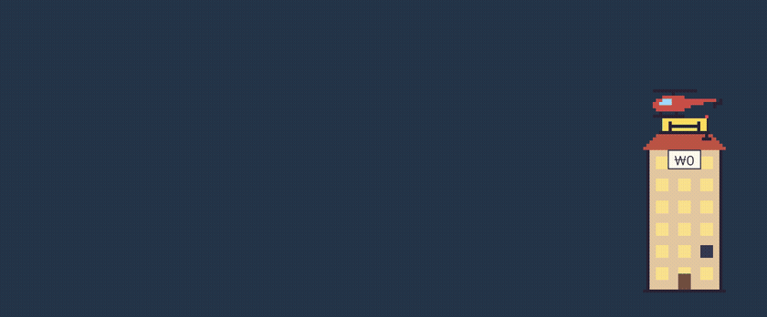
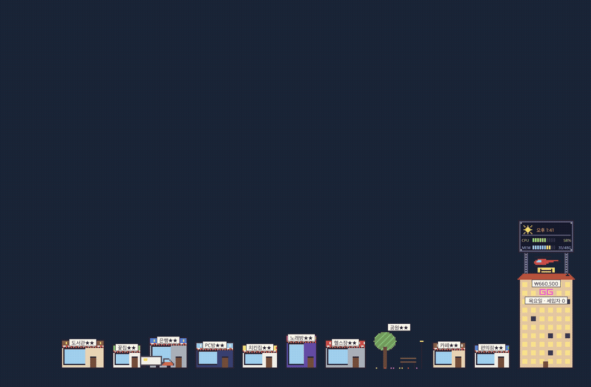
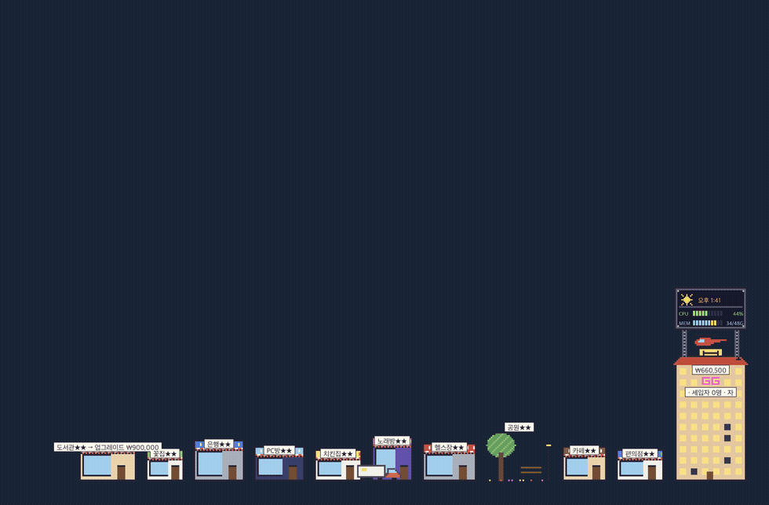

# 데스크톱 세입자 (Desktop Tenants)

열려 있는 macOS 앱 창이 픽셀 세입자들의 놀이터가 됩니다. 세입자들은 창 위를 걷고 사다리를 타고 오르며, 건물 옥상과 화면 가장자리를 돌아다닙니다. 떨어진 월세를 모아 건물을 증축하면 더 많은 세입자가 찾아옵니다.


<details>
<summary>사다리를 타고 오르는 장면</summary>


</details>

## 다운로드와 실행

[macOS Apple Silicon용 v0.1.0 미리보기](https://github.com/saechimdaeki/GG/releases/tag/desktop-tenants-v0.1.0)에서 `DesktopTenants-macos-arm64.zip`을 받아 압축을 풀고 `DesktopTenants.app`을 실행하세요. macOS 12 이상이 필요합니다. 앱은 공증 없이 배포됩니다.

- 세입자를 드래그하면 잡아서 옮길 수 있습니다. 움직이면서 놓으면 그 방향으로 날아갑니다.
- 동전을 클릭하면 월세가 쌓입니다. 집 위에 마우스를 올리면 다음 증축 비용이 보이고, 클릭하면 증축합니다.
- 빈 영역의 클릭은 아래 앱으로 전달됩니다. 종료하려면 Dock의 앱 아이콘에서 **종료**를 선택하세요.
- 진행 중 모은 월세와 건물 층수는 자동 저장됩니다.

다른 모니터에서 실행하려면 터미널에서 다음처럼 실행하세요. `--screen 1`은 주 모니터입니다.

```bash
open -a /path/to/DesktopTenants.app --args --screen 2
```

## 첫 미리보기에서 볼 수 있는 것

- 앱 창의 윗면, 옥상, 화면 가장자리를 따라 걷고 점프하는 세입자
- 낮잠, 춤, 대화와 비에 반응하는 세입자 12종
- 3층에서 6층까지의 증축과 새 세입자 해금
- 화면 선택과 창이 겹친 구간에서의 이동

[사다리와 창 위 이동](production/qa/evidence/ladder-climb-2026-11-26.jpg) · [옥상과 화면 가장자리](production/qa/evidence/roof-and-top-edge-2026-11-26.jpg) · [두 번째 모니터](production/qa/evidence/screen2-long-walk-ladder-2026-11-26.jpg)

## 새 이벤트와 이사

현재 소스 빌드에서 아래 기능을 플레이할 수 있습니다. 위 다운로드 링크는 v0.1.0 미리보기입니다.

| 기능 | 플레이 GIF |
| --- | --- |
| **이사 트럭과 옥상 설비** — 트럭에서 새 세입자가 내리고, 길 앞의 세입자는 뛰어서 피합니다. 층수가 올라가면 옥상에 헬리패드와 안테나가 생깁니다. 창문 조명은 낮과 밤에 다르게 켜집니다. |  |
| **헬기 택시** — 줄로 세입자를 태워 다른 곳에 내려주고, 헬리패드가 있으면 옥상으로 돌아옵니다. |  |
| **UFO** — 광선으로 세입자 한 명을 데려갔다가 다른 장소에 돌려보냅니다. |  |
| **동전 소나기** — 화면 위에서 떨어지는 보너스 동전을 클릭해 월세를 모을 수 있습니다. |  |
| **화재 대피 훈련** — 세입자들이 높은 곳에서 내려와 현관 앞으로 모입니다. |  |
| **불꽃놀이** — 세입자가 환호하고 화면 위에 불꽃이 터집니다. 밤에는 자동으로 한 차례 열립니다. |  |

## 소스 빌드

Unity 6000.6.9f1과 Xcode Command Line Tools가 필요합니다. 프로젝트의 macOS 플러그인을 다시 만든 후 Unity에서 빌드합니다. Unity 에디터에서는 세입자 시뮬레이션을, macOS 플레이어에서는 데스크톱 오버레이와 앱 창 연동을 실행합니다.

```bash
cd desktop-tenants
bash tools/build-plugin.sh
"/Applications/Unity/Hub/Editor/6000.6.9f1/Unity.app/Contents/MacOS/Unity" \
  -batchmode -quit -projectPath "$PWD" -executeMethod Setup.BuildMac -logFile -
open Builds/Mac/DesktopTenants.app
```
