# 데스크톱 세입자 (Desktop Tenants)

열려 있는 macOS 앱 창이 픽셀 세입자의 놀이터가 됩니다. 세입자들이 창 위를 걷고, 사다리를 타고, 상점에 들르는 동안 월세와 상점 수익을 모아 동네를 키웁니다.

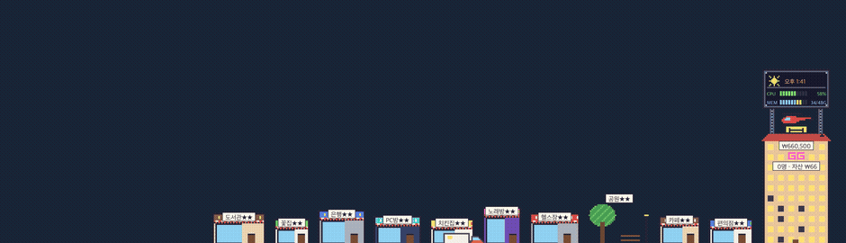

## 다운로드와 실행

[macOS Apple Silicon용 v0.1.0 미리보기](https://github.com/saechimdaeki/GG/releases/tag/desktop-tenants-v0.1.0)에서 `DesktopTenants-macos-arm64.zip`을 받아 압축을 풀고 `DesktopTenants.app`을 실행하세요. macOS 12 이상이 필요하며 앱은 공증 없이 배포됩니다.

아래 GIF는 최신 소스 빌드에서 촬영했습니다. v0.1.0 ZIP에는 첫 미리보기 기능이 들어 있습니다.

## 최신 소스에서 플레이하기

- 세입자를 드래그해서 옮기거나 움직이면서 놓아 던집니다. 잠시 마우스를 올려 두면 쓰다듬을 수 있습니다.
- 동전에 마우스를 가까이 가져가면 월세를 모읍니다. 집을 클릭하면 10층까지 올릴 수 있고, 빈 부지나 상점을 클릭하면 건설 또는 업그레이드합니다.
- 편의점, 카페, 공원 등 10종의 장소에 세입자가 찾아갑니다. 옥상 상태판에서 날씨, 시각, CPU 사용률과 메모리 사용량을 볼 수 있습니다.
- 빈 영역의 클릭은 아래 앱으로 전달됩니다. Dock의 앱 아이콘에서 종료할 수 있습니다.
- 다른 모니터에서 실행하려면 `open -a /path/to/DesktopTenants.app --args --screen 2`를 사용하세요. `--screen 1`은 주 모니터입니다.

## 플레이 GIF

<details>
<summary>아파트와 상점가 · GIF 3개</summary>

**옥상 상태판**


**사다리와 옥상 이동**

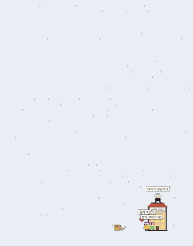

**이사 트럭**


</details>

<details>
<summary>날씨 · GIF 5개</summary>

**비**

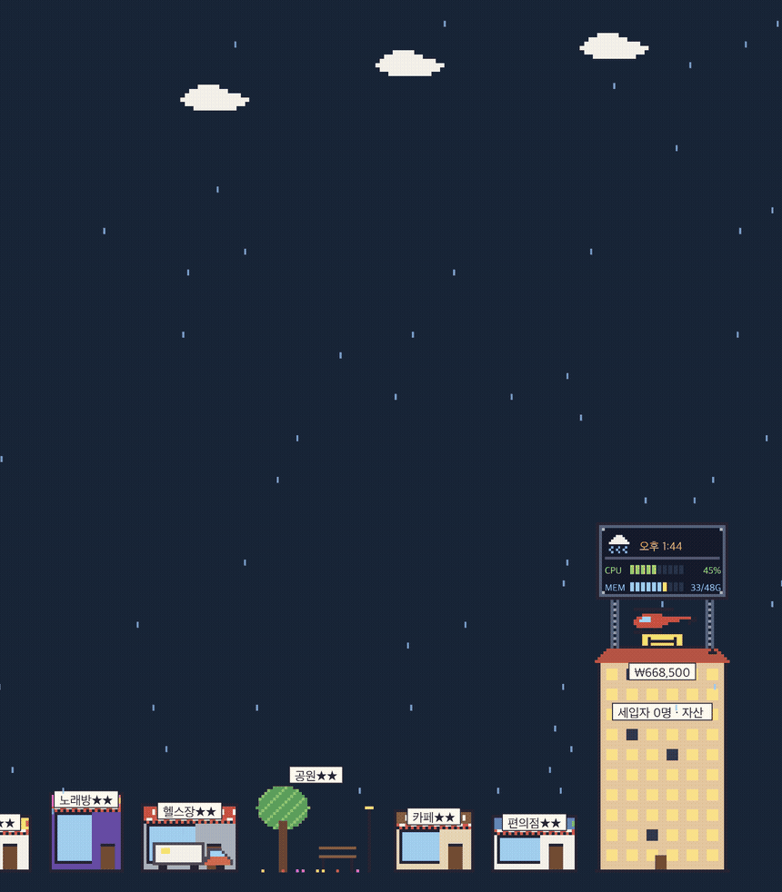

**뇌우**

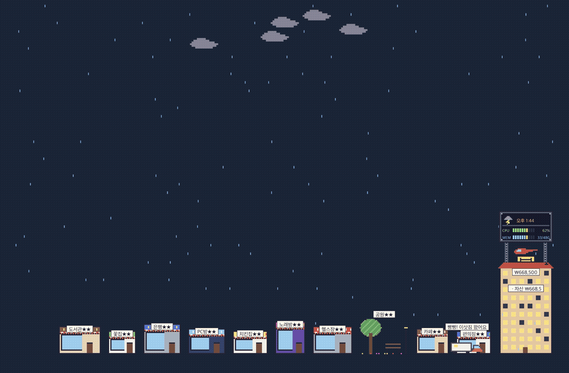

**눈**

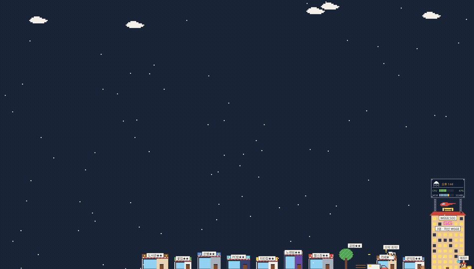

**강풍**

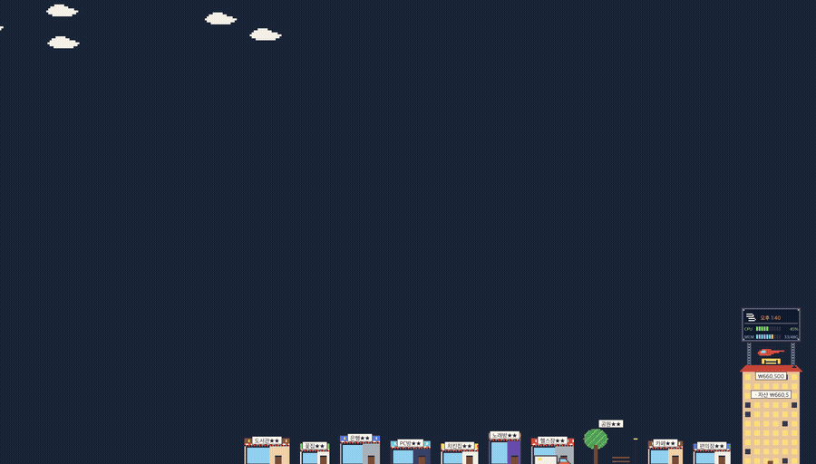

**무지개**

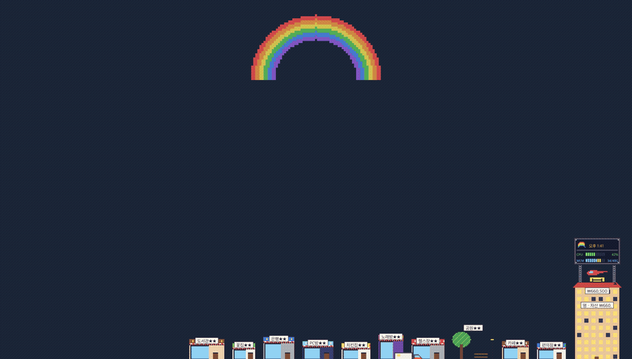

</details>

<details>
<summary>주민 이벤트 · GIF 7개</summary>

**생일**

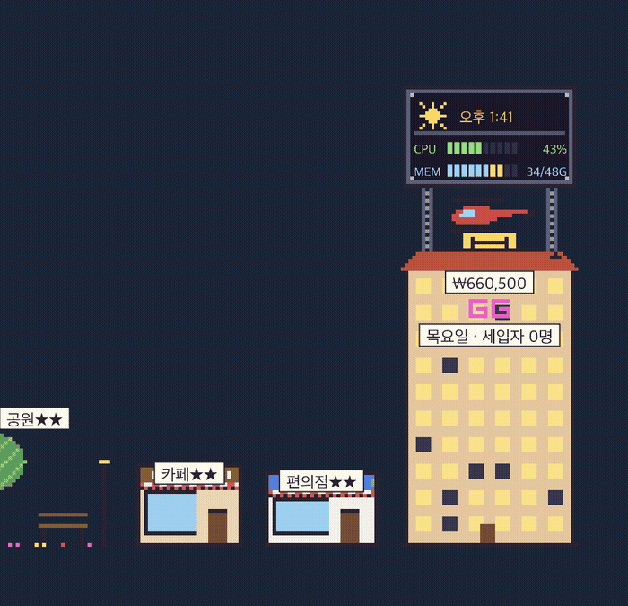

**연예인 방문**

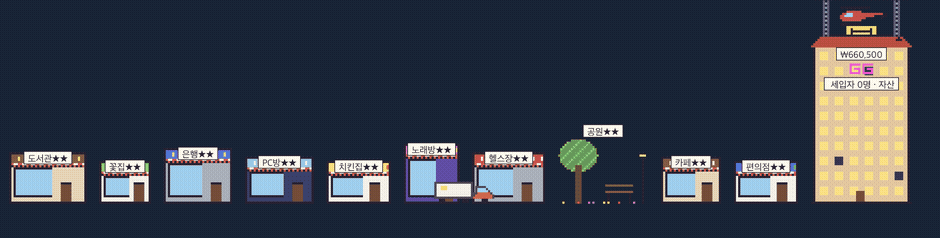

**아이스크림 트럭**


**마라톤**


**길거리 공연**

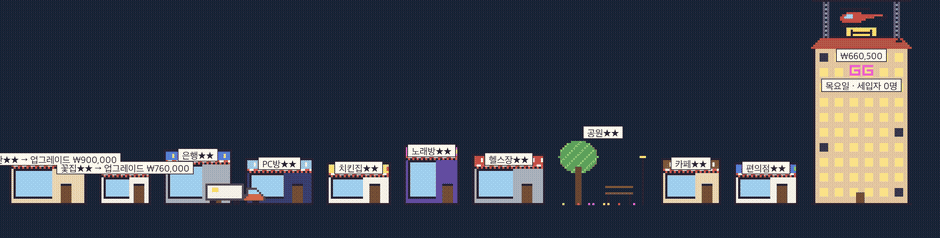

**고백**

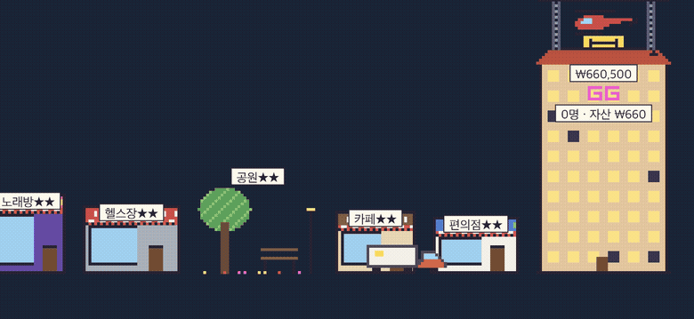

**반상회**

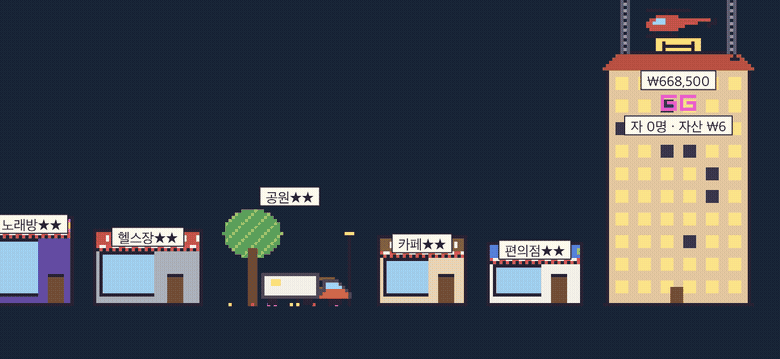

</details>

<details>
<summary>하늘과 돌발 이벤트 · GIF 10개</summary>

**헬기 택시**


**UFO**


**동전 소나기**


**화재 대피 훈련**

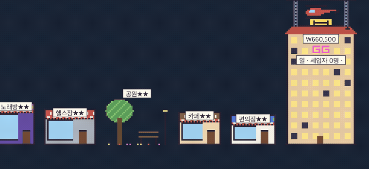

**불꽃놀이**


**정전**


**지진**


**새 떼**


**선물 비행기**


**유성우**


</details>

## 소스 빌드

Unity 6000.6.9f1과 Xcode Command Line Tools가 필요합니다. Unity 에디터에서는 세입자 시뮬레이션을, macOS 플레이어에서는 데스크톱 오버레이와 앱 창 연동을 실행합니다.

```bash
cd desktop-tenants
bash tools/build-plugin.sh
"/Applications/Unity/Hub/Editor/6000.6.9f1/Unity.app/Contents/MacOS/Unity" \
  -batchmode -quit -projectPath "$PWD" -executeMethod Setup.BuildMac -logFile -
open Builds/Mac/DesktopTenants.app
```
