# 유령집 이삿짐센터 (Haunted Movers)

친구 2~4명이 매일 모양이 바뀌는 귀신 들린 저택에 들어가 고물을 건져 트럭에 싣고, 몬스터를 피해 시간 안에 빠져나오는 협동 호러 게임 (리썰 컴퍼니식 규칙). 기획: [`design/game-brief.md`](design/game-brief.md)

<p align="center">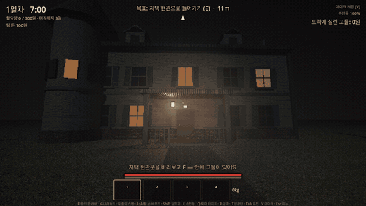<br><sub>트럭에서 저택으로 → 문을 열고 들어가 스캔 → 오르골인 줄 알았던 미믹</sub></p>

## 이런 게임

- **매일 바뀌는 저택** — 거실·침실·주방·서재·창고·욕실이 날마다 새로 배치되고, 문을 열고 닫으며 탐색
- **고물 줍기와 4칸 인벤토리** — 무거울수록 느려지고, 우클릭 스캔으로 값어치 확인, 옷장·서랍 뒤지기
- **괴물 5종** — 쳐다보면 멈추는 마네킹, 머리에 달라붙는 먼지귀신, 돌진하는 박제 멧돼지, 오르골로 위장한 미믹, 벽을 통과하는 소복 귀신
- **싸우거나 도망치거나** — 쇠지렛대·삽·섬광탄·퇴마 테이프, 손전등으로 유령 쫓기, 체력 100
- **2~4인 온라인** — Steam 없이 같은 와이파이·IP로 접속, 근접 음성 채팅과 트럭 무전

## 플레이 화면

**저택과 트럭**

| | | |
|---|---|---|
| 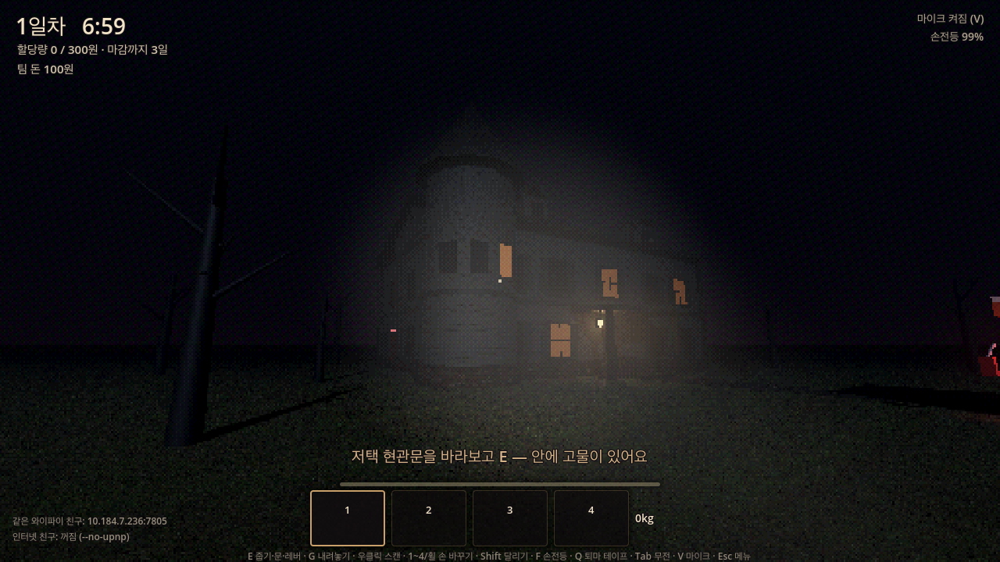 | 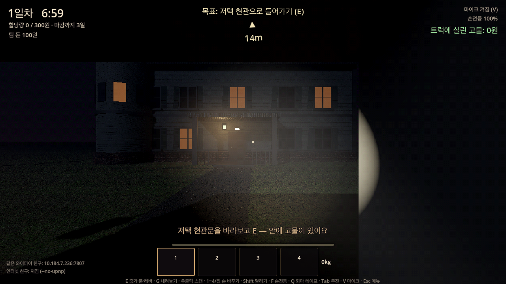 | 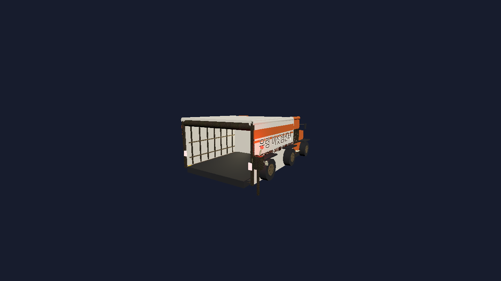 |
| 밤의 저택 | 첫 목표와 방향 안내 | 이삿짐 탑차 — 여기에 싣는다 |

**저택 안**

| | | |
|---|---|---|
| 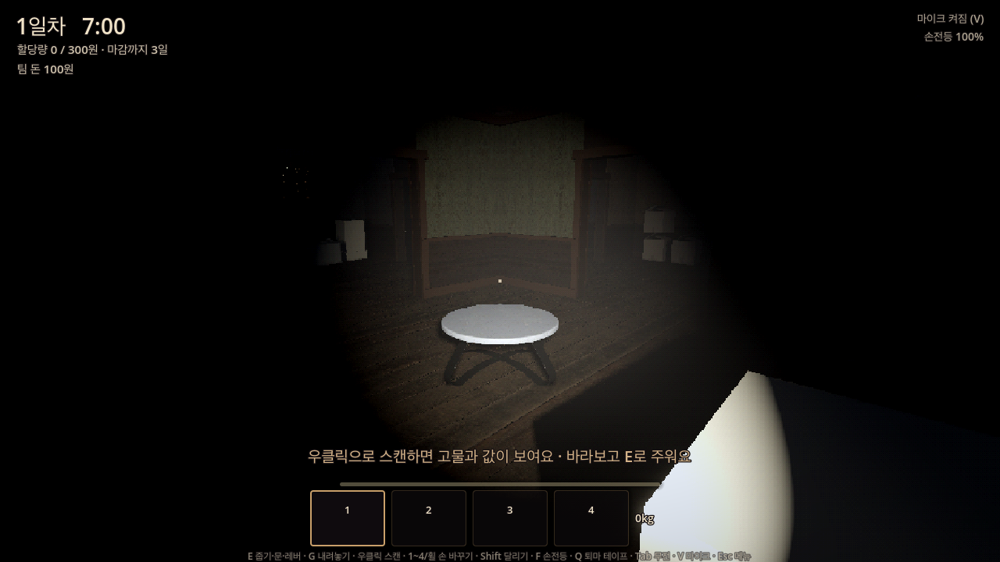 | 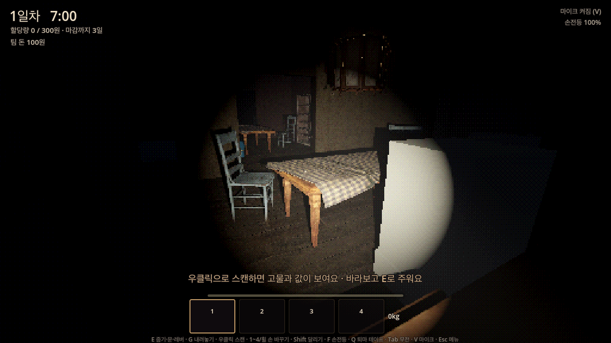 | 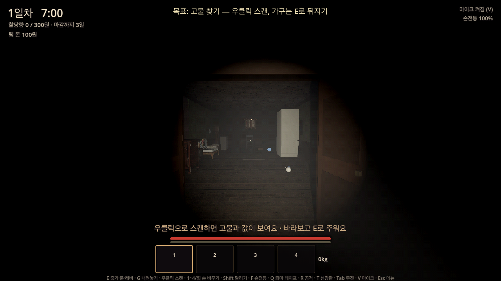 |
| 손전등 하나로 거실 탐색 | 서재 — 식탁과 의자 | 문을 열면 다음 방 |

**고물 찾기**

| | | |
|---|---|---|
| 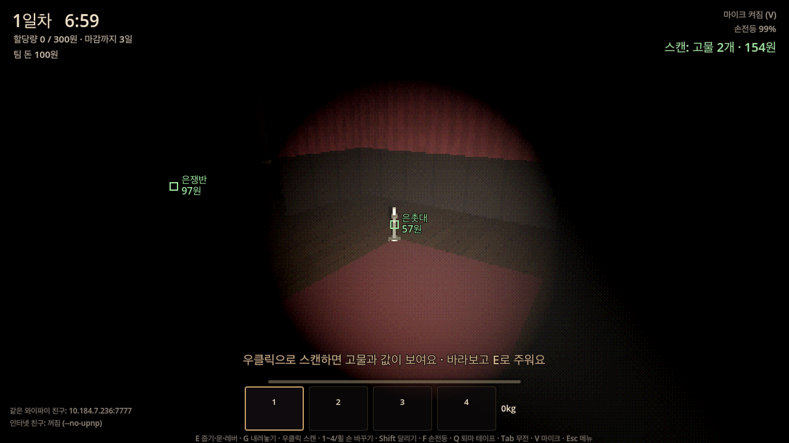 | 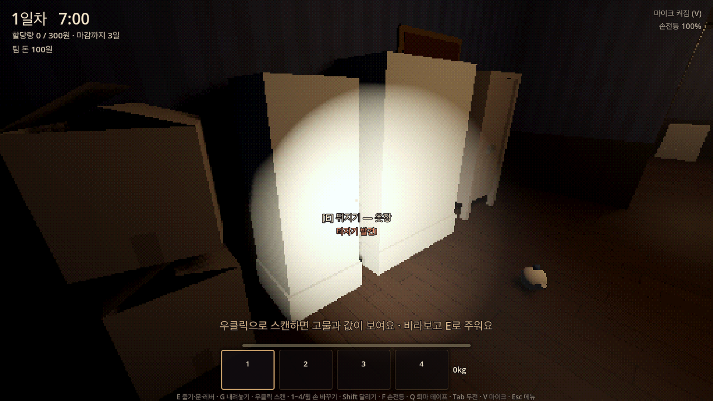 | 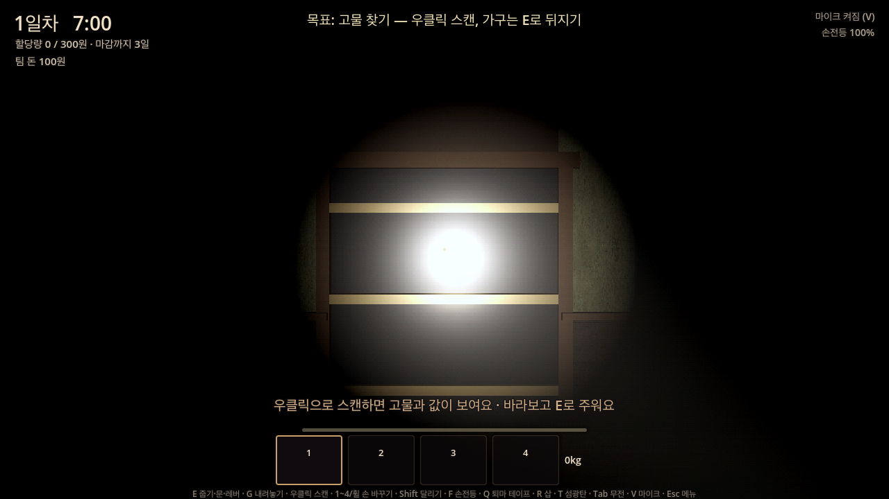 |
| 우클릭 스캔 — 보이는 고물과 값 | 가구 뒤지기 — 타자기 발견! | 열쇠로 여는 금고방 |

**괴물**

| | | |
|---|---|---|
| 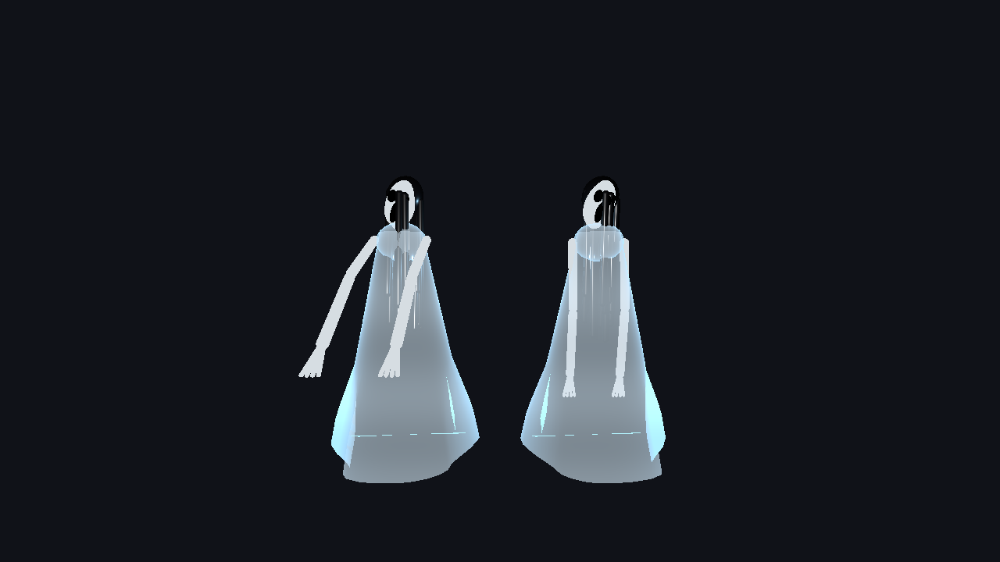 | 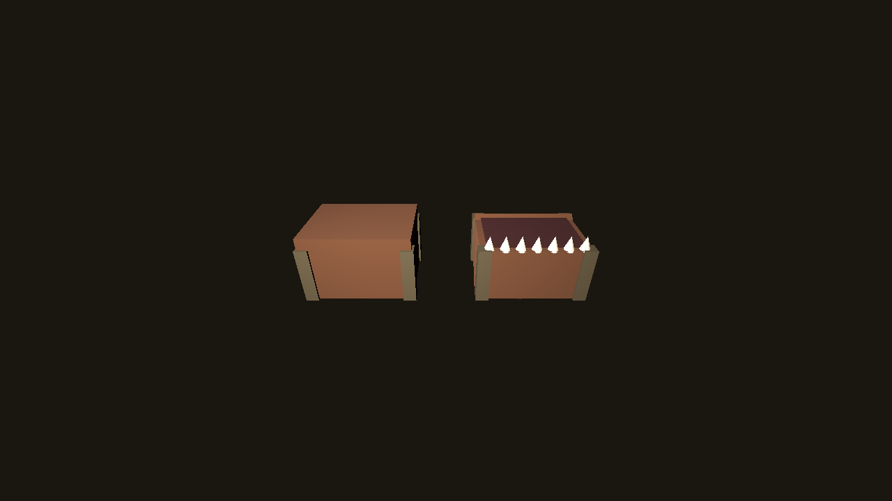 | 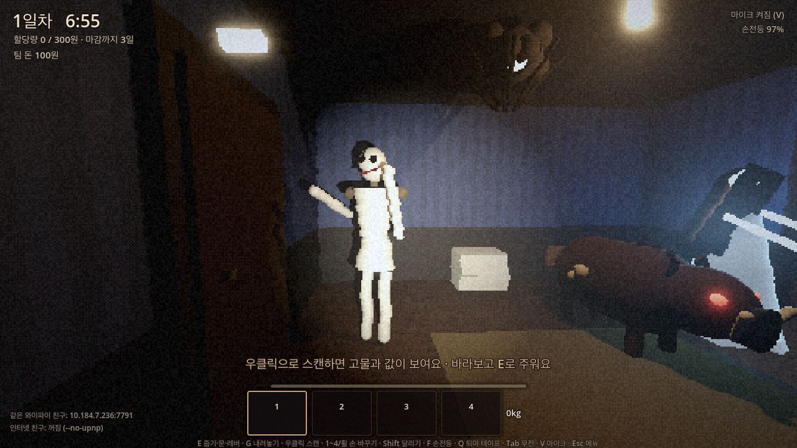 |
| 소복 귀신 (평소 / 쫓을 때) | 미믹 (오르골인 척 / 깨어남) | 마네킹·먼지귀신·멧돼지·유령 |

**위험과 도구**

| | | |
|---|---|---|
| 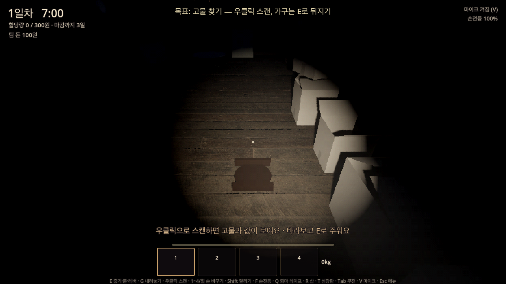 | 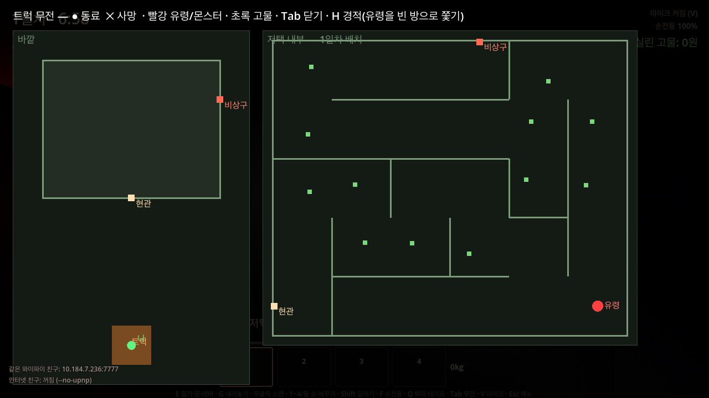 | 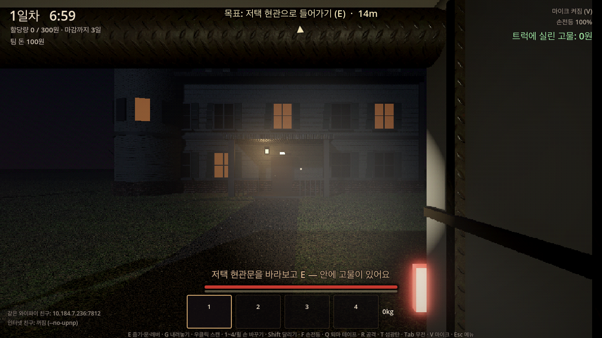 |
| 곰덫과 삐걱대는 마루 | 트럭 무전 — 저택 지도 | 체력·스태미나 HUD |

## 실행

```bash
godot --headless --import   # 클론 직후 한 번
godot                       # 메뉴에서 호스트 / 참가
```

### 친구랑 같이 하기 (Steam 없이)

- **같은 와이파이:** 한 명이 "호스트". 나머지는 메뉴의 "같은 와이파이에서 찾은 게임"에 뜬 버튼을 누르면 끝 (IP 입력 필요 없음)
- **인터넷 너머:** 호스트 화면 왼쪽 아래 "인터넷 친구:" 주소(예: `123.45.67.89:7777`)를 친구에게 보내고, 친구는 메뉴 "호스트 주소" 칸에 넣고 "주소로 참가"
  - 호스트가 공유기 포트를 자동으로 엶(UPnP). 공유기가 UPnP를 안 받으면 화면에 그렇다고 뜸 → 공유기 설정에서 **UDP 7777** 포트포워딩을 직접 열기
  - 중계 서버는 없음: 둘 다 공유기 뒤 + UPnP 안 됨 + 포트포워딩 불가면 접속 안 됨 (그땐 Hamachi·Tailscale 같은 가상 LAN을 쓰면 "같은 와이파이"처럼 됨)

주소로 참가하면 연결이 완료될 때까지 메뉴가 유지됩니다. 연결 중에는 취소할 수 있고, 10초 안에 연결되지 않으면 실패 안내 후 다시 참가하거나 호스트를 시작할 수 있습니다.

같은 컴퓨터에서 둘이 테스트 (창 2개):

```bash
godot -- --host
godot -- --join 127.0.0.1     # 또는 --join-lan (LAN에서 찾은 첫 게임에 자동 참가)
```

실행 파일 만들기 (Godot 4.7.2 export 템플릿 필요):

```bash
godot --headless --export-release "macOS" build/macos/HauntedMovers.zip
godot --headless --export-release "Windows" build/windows/HauntedMovers.exe
```

릴리스 태그를 푸시하면 다른 게임과 함께 자동 빌드됨 (`.github/workflows/release.yml`).

## 조작

E(또는 클릭): 줍기·가구 뒤지기·문 열기·출발 레버·동료 구하기 · G: 손에 든 것 내려놓기 · 우클릭: 스캔(보이는 고물과 값) · 1~4/휠: 손 바꾸기 · Shift: 달리기(스태미나) · F: 손전등 · Q: 퇴마 테이프 · R: 공격(쇠지렛대/삽) · T: 섬광탄 · Tab: 트럭 무전(트럭에서) · H: 경적(무전 중) · V: 마이크 · WASD 이동 · Space 점프 · F11 전체 화면 · Esc 메뉴

설정(메인 메뉴·Esc 메뉴): 마우스 감도, 음량, 화면 효과(픽셀·노이즈를 0으로 하면 꺼짐). `user://settings.cfg`에 저장

## 진행

- [x] 스토리 001 — 1인칭 이동, 물리 들기, 2인 온라인(ENet, 포트 7777). 소파(70kg)·냉장고(80kg)는 혼자 못 들고 둘이 들 수 있음
- [x] 스토리 002 — 트럭 짐칸에 실으면 보수 계산(가치 × 내구도 + 빈틈 없이 실은 보너스). 세게 부딪히면 가구가 상함. 빨간 "출발" 버튼
- [x] 스토리 003 — 2층 유령집(좁은 안쪽 문, 계단, 2층), 집 앞 트럭. 가구 6종에 얼굴. 저주: 옷장은 가까이 가면 깡충 도망, 피아노는 3초마다 들썩여 다 떨궈냄. 노을 + VHS 화면
- [x] 스토리 004 — 유령: 벽을 통과해 순찰하다 가까운 사람(가구 든 사람 우선)을 쫓아 기절시킴(4초, 들고 있던 것 떨굼). 전원 기절이면 그날 실패. 다가오면 화면 지지직
- [x] 스토리 005 — 3일 런: 하루 5분, 할당량 250/450/700원. 출발·시간 초과·전원 기절로 하루가 끝나고 상점(수레·밧줄·퇴마 테이프) → 다음 날 집 리셋. 미달 3회 파산, 3일 버티면 클리어

- [x] 오디오 — 파일 없이 코드로 만든 라운지 재즈 루프(유령이 가까우면 음이 뒤틀림), 효과음 4종(쿵·트럭 경적·유령 휙·동전)

- [x] Steam 없이 접속 — 같은 와이파이 자동 찾기(UDP 방송), 인터넷은 UPnP 자동 포트 열기 + 주소 표시, `IP:포트` 입력. 유령은 매일 아침 20초 잠

- [x] 리썰 컴퍼니식 규칙 — 유령에게 처음 잡히면 **기절**(4초, 유령은 다른 방으로 물러남), 같은 날 두 번째로 잡히면 **사망**(관전), 트럭은 시간이 다 되면 **자동 출발**(30초 전 경고)하고 못 탄 사람은 사망, 사망자 1명당 벌금 50원, **전원 사망 시 이번 할당량 기간에 모은 돈 전부 잃음**. 할당량은 3일마다 마감되고 달성하면 1.5배로 커짐 — 못 채울 때까지 끝없이 (미달 = 해고)

- [x] 정전·손전등 배터리 — 하루 2분이 지나면 집 전구가 전부 꺼짐(알림). 손전등은 켜 둔 동안 배터리가 닳고(2분 30초), 다 닳으면 안 켜짐. 트럭 근처에 있으면 충전(12초에 가득). 죽으면 살아 있는 동료 화면 관전 (2인 실제 접속 테스트로 확인)

- [x] 트럭 무전 — 트럭 근처에서 Tab: 집 지도(동료 위치·1층/2층·사망, 유령, 남은 가구)를 보며 제자리에 섬. 무전 중엔 내 목소리가 거리와 상관없이 모두에게 들리고, 동료 목소리도 크게 들림. H: 경적으로 유령을 트럭 쪽으로 12초 유인(45초 쿨다운) — 동료를 구하는 대신 트럭에 있는 내가 위험

- [x] 지하 창고 — 집 1층 왼쪽 벽 "지하실" 문으로 내려가는 미로. **매일 모양이 바뀜**(4×4 → 5×4 → 5×5방, 방 하나 6m). 금고(650원)·꽃병·초상화·궤짝 같은 비싼 짐은 지하에만 있음. 미로 가장 먼 곳에 **비상구** → 집 뒷마당(반대로도 들어감). 가구도 문을 통과함. 트럭 무전 지도가 화면 전체로 커지고 집·지하를 나란히 보여줌
- [x] 지하 몬스터 3종 (시간이 지날수록 하나씩 깨어남, 날이 갈수록 많아짐) — **마네킹**: 아무도 안 볼 때만 빠르게 다가와서 닿으면 사망, 계속 쳐다보며 물러나야 함. **먼지귀신**: 천장에 붙어 있다가 밑을 지나가면 머리에 떨어져 앞이 깜깜해지고 7초 뒤 사망 — 동료가 나를 클릭해야 떼어짐. **박제 멧돼지**: 돌아다니다 일직선으로 보이면 콧김 후 돌진, 맞으면 사망, 벽에 박으면 3초 멍함

- [x] **리썰식 루프로 전면 개편** — 무거운 가구 끌기를 없애고 **작은 고물 줍기**로 바꿈. 트럭은 큰 저택 앞에 서고(바깥엔 현관·옆 비상구만), 현관 E → **매일 바뀌는 저택 내부**(6×5 → 6×6 → 7×7방, 방마다 벽지 색·먼지 덮인 가구·러그, 전구 몇 개만). 고물 12종(은촛대~작은 금고, 깊은 방일수록 값 ↑) 하루 12/15/18개. **4칸 인벤토리**, 양손 짐(축음기·금고)은 손이 묶임, 무게만큼 느려짐, Shift 달리기+스태미나. **우클릭 스캔**: 보이는 고물·몬스터 이름과 값, 합계. 트럭 짐칸에 내려놓거나 들고 트럭에 있으면 정산. 죽으면 들고 있던 건 그 자리에 떨어짐. 유령·몬스터가 저택 전체를 돌아다니고 마네킹·멧돼지는 **발소리**. 경적은 유령을 사람 없는 방으로 쫓음. 화면: 밤하늘·저택 외관·현관등, RGB 번짐·스캔라인 제거, HUD 정리(시계·할당량 / 인벤토리 칸·스태미나 / 조준 시 [E] 안내)
- [x] 괴물 디자인 개편 — 유령은 달걀 모양 대신 **소복 귀신**(긴 검은 머리로 얼굴을 가리고 빨간 눈 하나, 쫓을 때 긴 팔을 뻗음). 마네킹은 금 간 도자기 얼굴에 그려진 웃음, 먼지귀신은 다리 8개 달린 털뭉치 외눈, 박제 멧돼지는 터진 솔기·등 갈기·엉덩이에 트로피 명판. 손전등 F 누르면 켬/끔 표시
- [x] 유령 회피: 손전등을 비추면 유령이 비명 지르며 2.5초 물러남(대신 배터리 6배 소모). 저택 가구를 Kenney Furniture Kit(CC0) 모델 15종으로 교체(색은 바래게), 방마다 가구 1~3개
- [x] 방 채우기 — 방마다 종류(거실·침실·주방·서재·창고·욕실, 입구는 현관 홀): 닫힌 벽마다 그 방 가구를 줄지어 놓고(벽 길이의 75%까지), 주방·서재는 가운데 식탁+의자, 거실은 원탁, 창고는 박스를 2단으로 쌓음. 벽에 금박 액자. 고물은 가구 안에 안 생김. 저택 안 조금 더 밝게(전구 확률 45%)
- [x] 가구 뒤지기 — 옷장·서랍장·책장·냉장고·오븐·세탁기·이삿짐 박스에 E: 35% 확률로 고물이 숨어 있다가 앞으로 떨어짐("○○ 발견!"), 없으면 "아무것도 없어요". 하루 한 번(누가 뒤졌든 모두에게 "이미 뒤졌어요"), 다음 날 다시 닫힘. 참가자도 호스트를 거쳐 뒤짐(실제 접속 테스트)
- [x] 실사풍 텍스처·가구 — Poly Haven(CC0): 벽지(낡은 벽지, 방 테마 색으로 물들임)·나무 바닥·회벽 천장·카펫, 집 외벽 판자·지붕 기와·자갈길·풀밭. 가구 15종 교체(고딕 옷장·고딕 침대·낡은 책장·흔들의자·괘종시계·장식장·협탁 등), 벽엔 액자·시계 모델, 불 켜진 방엔 샹들리에. 주방·욕실·박스는 Kenney 유지
- [x] 덜 네모나게 — 실내 벽에 나무 판넬(1m)·걸레받이·천장 몰딩·문틀. 집 외관에 둥근 모서리 탑(뾰족 지붕), 지붕창 2개, 돌 기초, 모서리 판·층 띠, 앞창 덧문·창턱, 현관 난간·계단. 달빛 조금 밝게. 발소리는 노크 소리(95Hz 사인) → 나무 바닥 스치는 소리(저역 통과 잡음 + 뒤꿈치·앞꿈치)
- [x] 발소리 녹음(CC0, TinyWorlds): 저택 안은 나무 바닥 3종, 밖은 자갈·낙엽 — 매 걸음 무작위·음높이 살짝 다르게. 몬스터 발소리도 나무 바닥. 화면 효과 기본값 1.0 → 0.25(도트·색 뭉개짐이 텍스처를 가렸음), 벽에 반사광(SSIL)
- [x] 유령 다시 만들기 — 둥근 얼굴에 퀭한 눈·비명 지르는 입, 흔들리는 긴 머리카락 18가닥, 관절 두 개인 긴 팔과 손가락, 가끔 머리가 순간이동하듯 튐. 첫날 괴물을 빨리 등장(25초 먼지귀신, 40초 멧돼지, 70초 마네킹)
- [x] 첫 1분 안내 — 화면 위에 지금 목표(현관으로 → 고물 찾기 → 밖으로 → 짐칸에 G)와 방향 화살표·거리
- [x] 상점 장비 — 삽(R: 앞의 괴물 5초 기절, 팀 전원), 섬광탄(T: 9m 안 괴물 6초 기절·유령 도망, 화면 하얗게), 무전기(어디서든 동료 목소리)
- [x] 갈 곳 고르기 — 상점에서 내일 목적지: 시골집(작고 안전, 고물 적음) / 저택 / 폐병원(80원, 크고 위험, 고물 값 1.6배, 괴물 빨리 나옴, 차가운 조명)
- [x] 함정·금고방 — 삐걱대는 마루(밟으면 유령이 그쪽으로 옴), 곰덫(밟으면 3초 못 움직임, 한 번), 막다른 방 하나는 쇠문 금고방: 집 반대편 바닥의 열쇠를 들고 E로 열면 비싼 고물 3개
- [x] 다듬기 — 뒤진 가구는 앞이 열린 채(검은 구멍), 일부 방은 벽 없이 이어진 큰 홀, 괴물은 가구를 돌아서 걸음
- [x] 트럭 새로 — 크림색 탑차 화물칸(둥근 지붕 모서리·주황 띠·안쪽 갈비대·고정 레일), 나무 바닥과 노랑·검정 경고선, 말아 올린 셔터, 경사 앞유리·라디에이터 그릴·범퍼, 진짜 빛을 내는 전조등, 휠·볼트 달린 바퀴와 흙받이, 사이드미러·발판·문손잡이, 미등·차폭등, 큰 회사 이름. 출발 레버는 기둥 위 손잡이 + "출발 레버" 표지
- [x] 싸우기 — 모두 쇠지렛대를 들고 시작(R: 앞의 괴물 공격, 0.7초마다). 상점 녹슨 삽은 공격력 2배. 체력: 먼지귀신 1·미믹 3·멧돼지 4, 마네킹(돌)·유령은 못 죽임. 죽인 괴물은 고물을 떨굼(멧돼지·미믹 2개). 휘두를 때 1인칭으로 무기 모델이 보임
- [x] 새 괴물 미믹 — 바닥 고물 사이에 오르골인 척 숨어 있음(스캔에도 "오르골 74원"으로 뜸). 1.8m 안에 들어가면 뚜껑이 열리며 이빨을 드러내고 쫓아옴. 물리면 2초 넘어짐, 하루 3번째로 물리면 사망. 하루 1/2/3마리
- [x] 긴장감 — 사냥 중인 괴물이나 쫓는 유령이 12m 안이면 심장 소리(가까울수록 빠르고 크게, 분당 55→160)와 화면 가장자리가 붉게 맥동
- [x] 체력 100 — 한 방에 죽지 않음: 멧돼지 들이받기 45(받고 나면 멈춤), 미믹 물기 30, 마네킹 60(때리고 3초 멈춤), 유령 50, 먼지귀신은 머리에 붙어 초당 8. 0이 되면 사망, 다음 날 가득. 화면 아래 빨간 체력 바, 맞으면 화면이 붉게 번쩍. 먼지귀신은 R로 내 머리에서 떼어낼 수 있음(다리가 눈앞을 가리던 것 숨김)
- [x] 방문 — 방 사이 문틀의 60%에 양쪽 여닫이문(처음엔 닫힘). E로 열고 닫기(참가자도 호스트를 거쳐, 모두에게 보임). 닫힌 문은 시야·스캔·마네킹 시선을 막음. 괴물은 닫힌 문을 쾅 열고 들어옴(소리로 들림)

**MVP 5개 스토리 + 오디오 + Steam 없는 온라인 구현됨.** 남은 것: 사람 2~4명 플레이테스트, (나중에) Steam 로비

## 테스트

```bash
godot --headless --path . -s res://tests/smoke/run_check.gd
python3 tests/integration/run_connection_checks.py
```

네트워크 통합 테스트는 실패·취소·재시도, 호스트 전환, 실제 두 프로세스 접속, 2일차 팀 돈·고물 동기화, 참가자가 호스트를 거쳐 고물을 줍는지, 참가자 사망·관전을 검사합니다.

## 크레딧

- 가구 3D 모델: [Kenney Furniture Kit](https://kenney.nl/assets/furniture-kit) (CC0) — `assets/models/furniture/`
- 발소리: [Different steps on wood, stone, leaves, gravel and mud](https://opengameart.org/node/5701) by TinyWorlds (CC0) — `assets/audio/footsteps/`
- 가구·소품 모델, 벽·바닥·외벽 텍스처: [Poly Haven](https://polyhaven.com) (CC0) — `assets/models/polyhaven/`, `assets/textures/polyhaven/`
