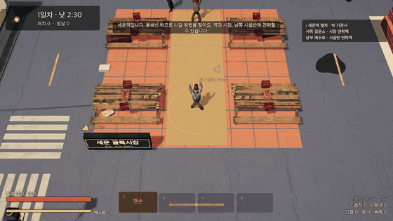
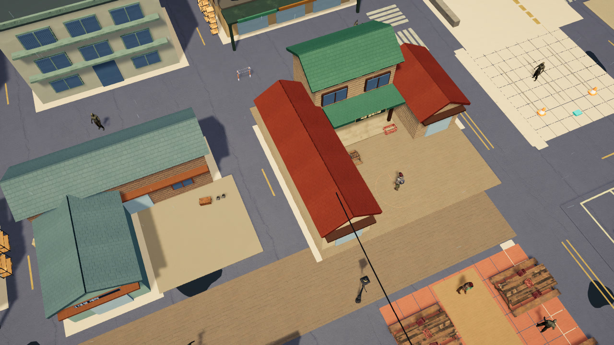
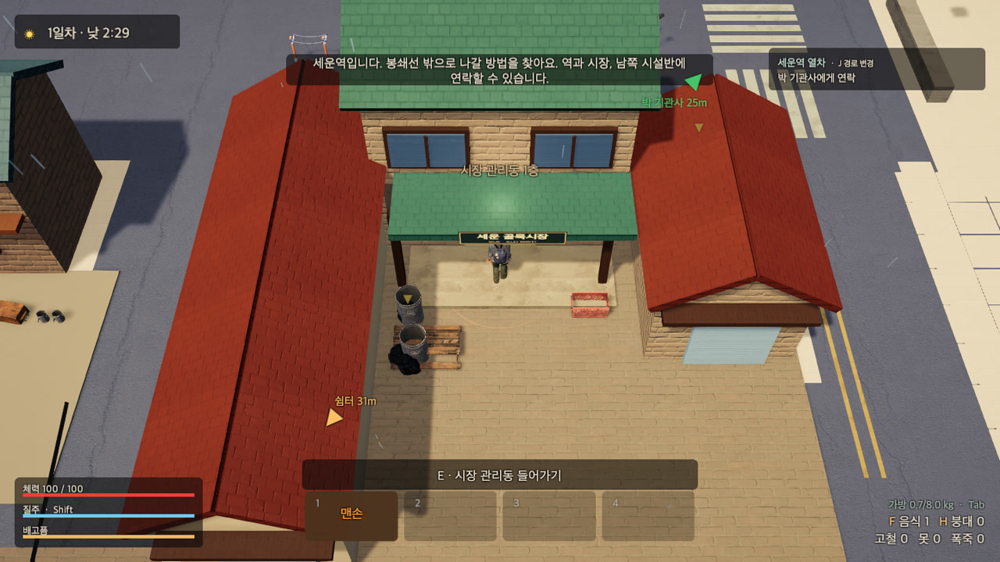
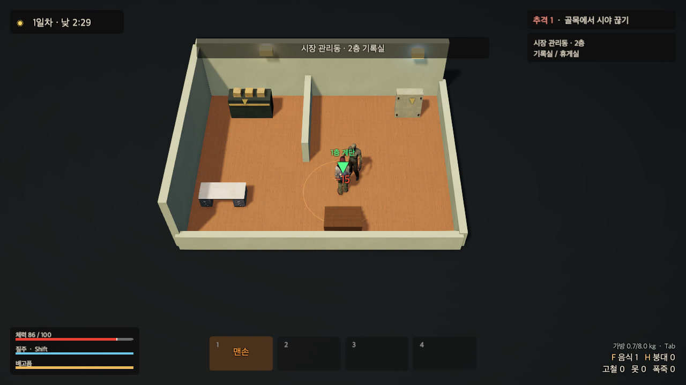
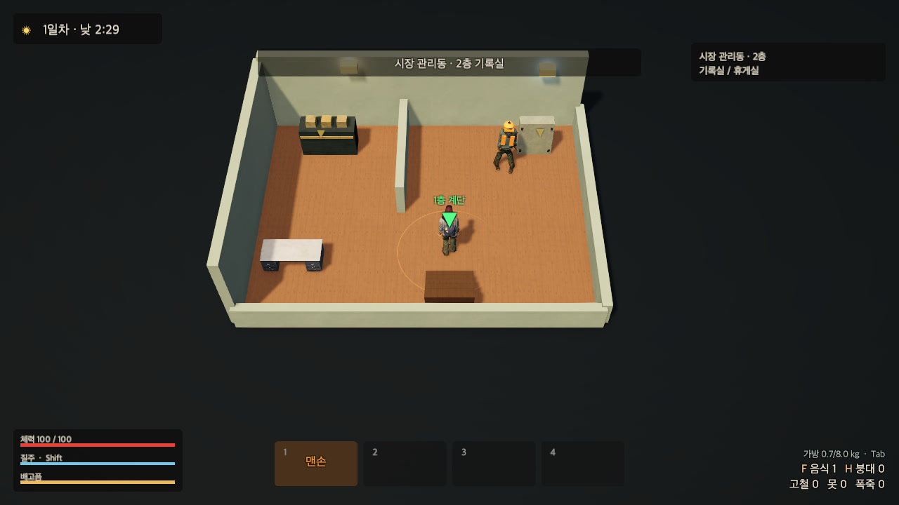
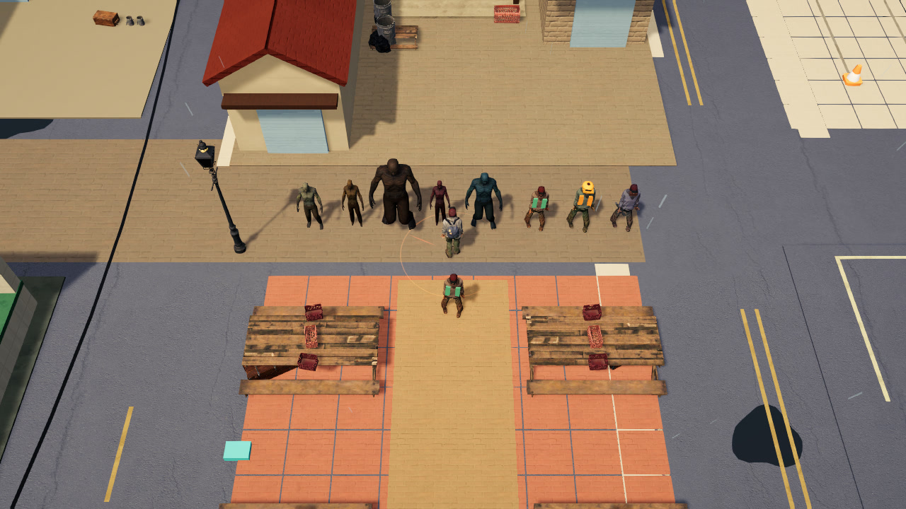
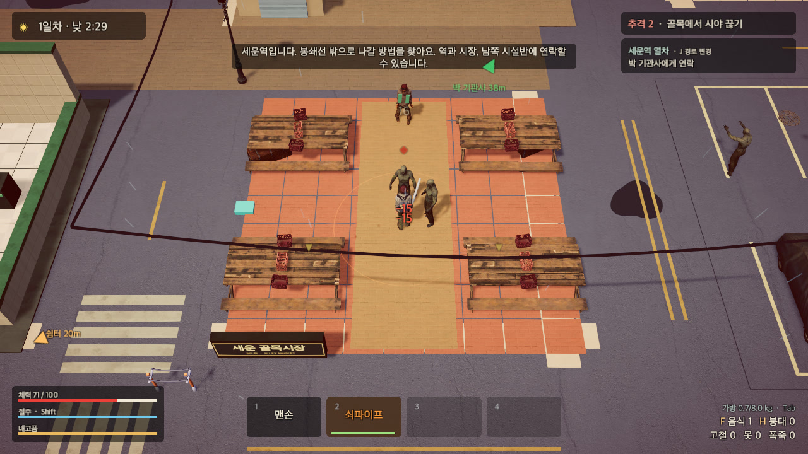
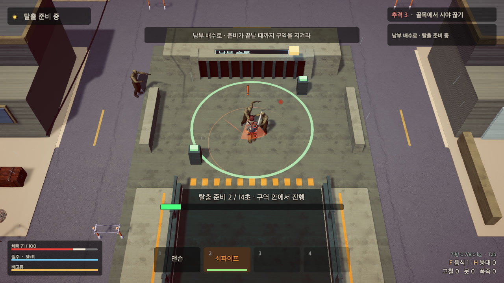

# 막차까지 · Last Train

봉쇄된 서울 구도심에서 시설 기사 민서는 세운역 박 기관사의 무전을 받습니다. 낮에는 상점과 골목을 수색하고, 밤에는 쉼터에서 버팁니다. 열차, 운송차, 남부 배수로 중 한 길을 준비해 도시를 빠져나가는 탑다운 생존 액션입니다.



## 시장 관리동과 도시 탐색

시장 뒤 **ㄷ자 안뜰**로 들어가 관리동 문 앞에서 **E**를 누르거나 열린 출입구를 걸어서 통과합니다. 1층 접수함은 **E를 길게** 눌러 수색합니다. 안쪽 계단에서 **E**를 누르면 2층 기록실과 휴게실로 올라갑니다.

2층에는 기록 보관함과 구급함이 있습니다. 첫 방문 때 판에 따라 감염자나 다친 관리인을 만나고, 아무도 없는 날도 있습니다. 관리인에게 붕대를 주면 고철을 받습니다. 새벽 약국, 한빛 편의점, 세운 철물도 문 앞에서 **E**로 들어갈 수 있습니다.

| 시장 뒤 안뜰과 세탁소 | 관리동 출입구 |
|---|---|
|  |  |

| 2층의 감염자 | 2층의 다친 관리인 |
|---|---|
|  |  |

| 장소 | 찾는 법 | 보급품 |
|---|---|---|
| 임시 배급소 | 쉼터 북서쪽의 대기열 담장 | 식량 |
| 시설반 야적장 | 쉼터 남서쪽의 자재 선반 | 고철 |
| 세운역 환승 주차장 | 시장 동쪽의 주차 차량 사이 | 퓨즈 |

서북쪽 주택가에는 기와지붕 집 사이 샛길이 있고, 중앙 시장 뒤 보행로는 동서 대로로 이어집니다. 북동쪽에는 역세권 아파트와 광장, 남쪽에는 하역장과 수로 양안 보행로가 있습니다.

## 감염자와 생존자

근접 공격은 **클릭 한 번에 가장 가까운 적 한 마리**를 때립니다. 휘두르기 전과 무기를 회수하는 동안에는 질주할 수 없습니다. 여러 마리가 붙으면 질주로 거리를 벌리고, 모퉁이에서 시야를 끊은 뒤 잠행으로 발소리를 줄일 수 있습니다.

질주형은 좁은 각도로 빠르게 공격하고, 거구는 오래 예고한 뒤 넓게 휘두릅니다. 정면 방호가 있는 감염체는 옆과 뒤가 약하며, 비명꾼은 주변 감염체를 끌어들입니다. 일부 낮에는 낯선 생존자가 보급품을 미끼로 접근을 유도합니다. 무기를 숨긴 단서를 보고 지나가거나, 매복이 시작되면 예고 방향을 보고 피할 수 있습니다.



## 탈출 방법

**J**로 추적하는 루트를 바꿀 수 있습니다. 연락책과 단서를 찾고 준비를 끝낸 뒤, 탈출 구역에서 **E**를 눌러 시작합니다.

| 루트 | 단서 | 탈출 준비 |
|---|---|---|
| 세운역 열차 | 정비 광장의 막차 운행표 | 박 기관사에게 연락하고 퓨즈 3개로 역 전력 복구 |
| 서쪽 검문소 | 장터의 운송차 정비 기록 | 시장 연락책에게 연락하고 고철 3개로 차량 수리 |
| 남부 배수로 | 시설반 근처의 수문 배관 도면 | 시설반에 연락하고 쇠파이프나 소방도끼로 밸브 두 개 개방 |

2일차 시장에서 윤서에게 붕대를 주면 운송차 정비 기록과 고철을 받습니다. 3일차에는 역 정비 광장에서 지호를 구조해 운행표와 퓨즈를 얻을 수 있습니다. 생존자 지원과 구조는 탈출 후 이야기에 반영됩니다.

| 쇠파이프 타격 | 남부 배수로 탈출 |
|---|---|
|  |  |

## 조작

| 행동 | 키 |
|---|---|
| 이동 · 질주 · 잠행 전환 | WASD · Shift · C 또는 왼쪽 Ctrl |
| 조준 · 공격 | 마우스 · 왼쪽 클릭 |
| 출입 · 계단 · 대화 | E |
| 수색 | E 길게 |
| 수색 목록 선택 · 챙기기 · 전부 챙기기 | ↑↓ · E 또는 Enter · F |
| 무기 변경 · 가방 | 1–4 또는 휠 · Tab |
| 먹기 · 붕대 · 루트 추적 변경 | F · H · J |
| 일시 정지 및 조작 안내 | Esc |

시작할 때 쉼터 비상 공구함에서 쇠파이프를 구할 수 있습니다. 철물점 무기 공구함에는 소방도끼가 있습니다.

## 실행과 빌드

로컬 macOS 빌드는 `Builds/Mac/LastTrain.app`에 있습니다. Unity 프로젝트는 **Unity 6000.6.9f1**에서 열고 `Assets/Scenes/Main.unity`를 실행합니다.

```bash
unity="/Applications/Unity/Hub/Editor/6000.6.9f1/Unity.app/Contents/MacOS/Unity"
"$unity" -batchmode -quit -projectPath "$PWD" -executeMethod Setup.BuildMac
open Builds/Mac/LastTrain.app
```

미디어는 로컬 라이선스 에셋을 설치한 macOS 빌드에서 캡처했습니다. Asset Store의 **Zombie**, **Free Scavenger**, **Japanese Otaku City**에서 선택한 에셋은 `python3 tools/import_store_art.py`로 가져올 수 있습니다. **HOLLOWS**는 `python3 tools/import_hollows.py --help`를 참고하세요. [제3자 에셋 고지](Assets/StreamingAssets/ThirdPartyArt.txt)
