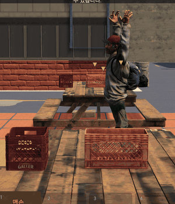
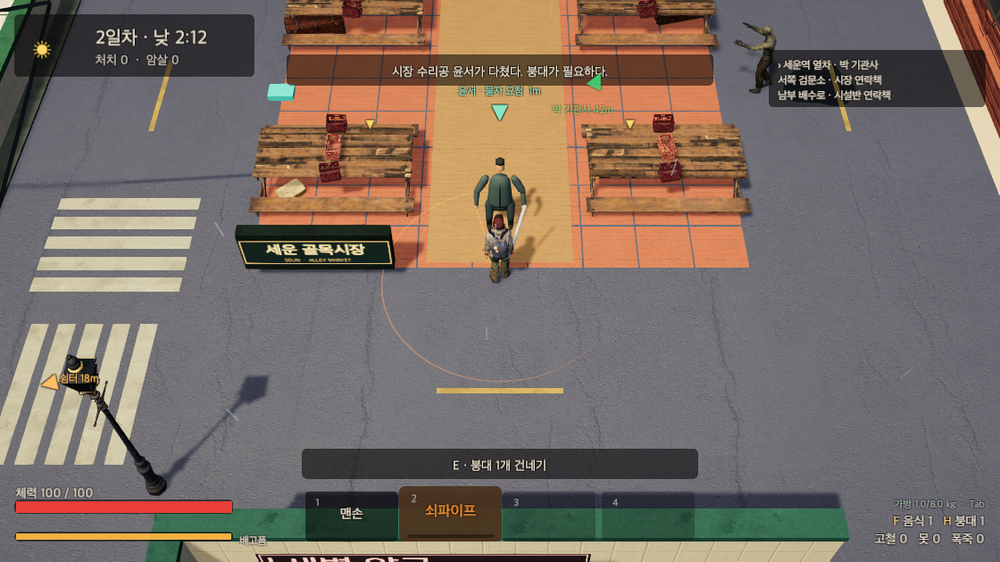
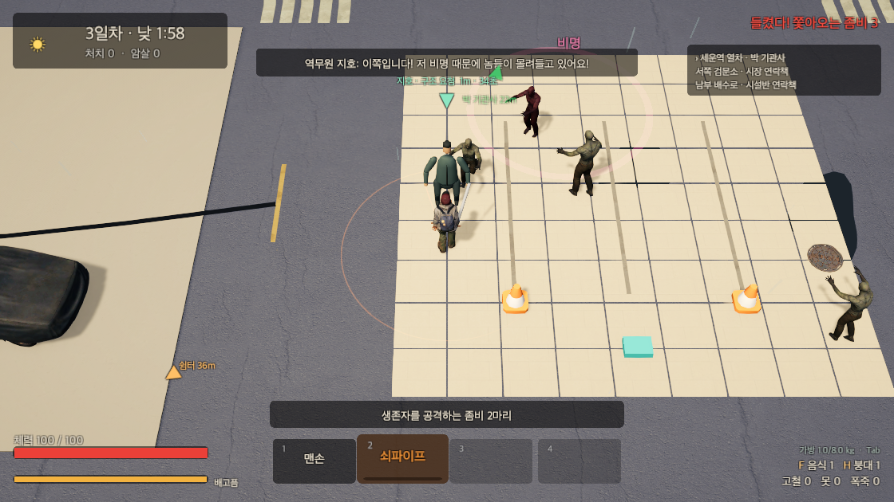
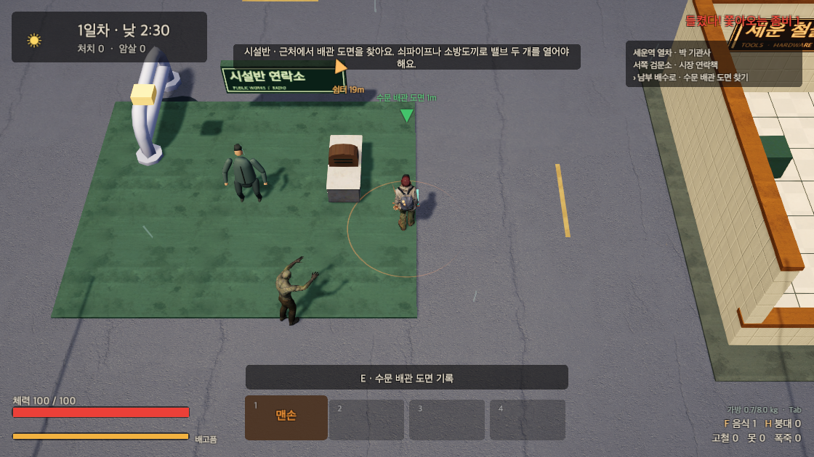
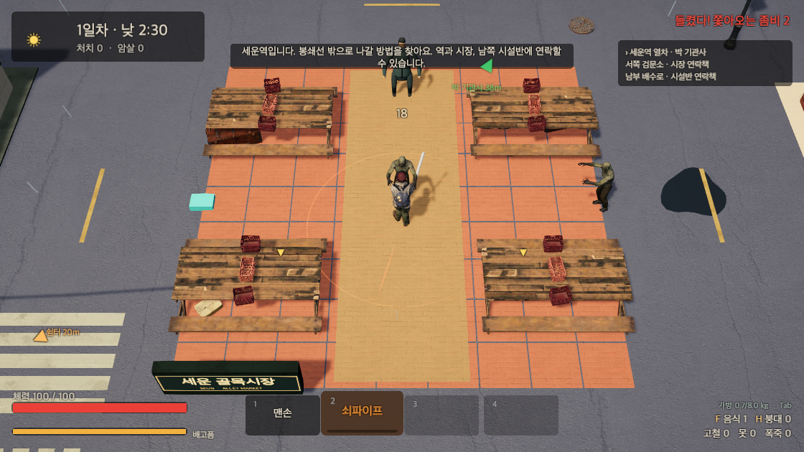
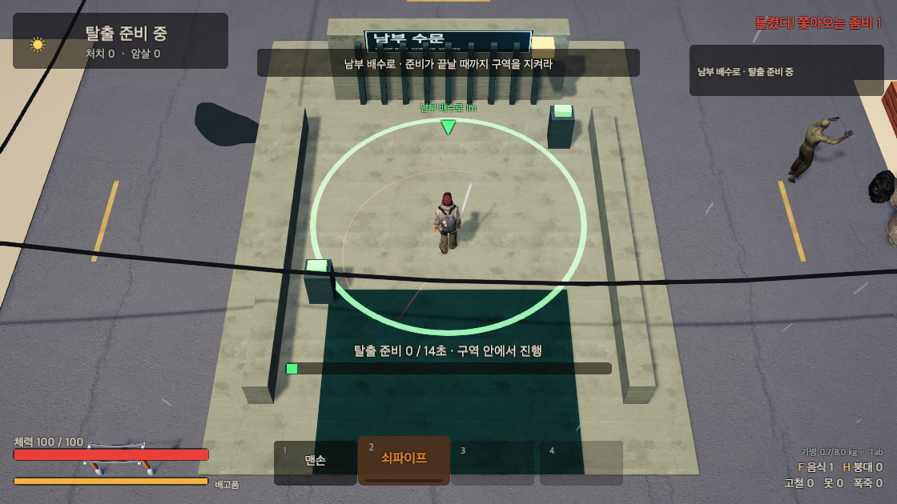

# 막차까지 · LastTrain

봉쇄된 도시에서 무전을 받은 시설 기사 민서. 낮에는 상점과 골목을 수색하고, 밤에는 쉼터를 지킨다. 역무원과 시장 연락책, 남쪽 시설반을 만나 각기 다른 탈출 계획을 조사한다.


 걷기·잠행·질주를 옆에서 본 모습. 시장 연락책·생존자 NPC도 민서와 같은 사실형 모델을 쓴다.

## 탈출 방법

연락책을 만나고 단서를 기록한 뒤, 준비 조건을 채운 통로에서 탈출을 시작한다. **J**로 추적하는 루트를 바꿀 수 있다.

| 루트 | 단서 | 탈출 준비 |
|---|---|---|
| 세운역 열차 | 정비 광장의 막차 운행표 | 박 기관사에게 연락하고 퓨즈 3개로 역 전력 복구 |
| 서쪽 검문소 | 장터의 운송차 정비 기록 | 시장 연락책을 만나고 고철을 모아 차량 수리 |
| 남부 배수로 | 시설반 근처의 수문 배관 도면 | 시설반에 연락하고 쇠파이프나 소방도끼로 밸브 두 개 개방 |

2일차에는 시장의 윤서가 붕대를 요청한다. 도와주면 정비 기록과 고철을 받는다. 3일차에는 역 정비 광장에 갇힌 지호를 구조할 수 있다. 구조하면 막차 운행표와 역 전력 복구에 쓸 퓨즈를 얻는다. 구조 성공이나 물자 지원 여부는 탈출 후 이야기에 반영된다.

비명꾼은 민서를 발견하면 주변 감염체를 끌어들이고, 방호 좀비는 정면에서 들어오는 근접 공격의 피해를 줄인다. 궤적을 피하면서 뒤를 잡거나 시야를 끊어 싸울 수 있다.

## 플레이 장면

| 시장의 붕대 요청 | 정비 광장 구조 |
|---|---|
|  |  |

| 배수로 단서 | 골목 전투 |
|---|---|
|  |  |



## 조작

| 행동 | 키 |
|---|---|
| 이동 · 질주 · 잠행 전환 | WASD · Shift · C 또는 왼쪽 Ctrl |
| 조준 · 공격 | 마우스 · 왼쪽 클릭 |
| 상호작용 · 수색 | E |
| 파밍 목록에서 선택 · 전부 챙기기 | ↑↓와 Enter · F |
| 무기 변경 · 가방 | 1–4 또는 휠 · Tab |
| 먹기 · 붕대 · 루트 추적 변경 | F · H · J |
| 일시 정지 및 조작 안내 | Esc |

쉼터 앞 비상 공구함에서 쇠파이프, 철물점 무기 공구함에서 소방도끼를 구할 수 있다. 가방에 넣을 물건을 골라 담거나 내려놓고 다시 챙길 수 있다.

## 빌드

Unity Hub에서 이 폴더를 **Unity 6000.6.9f1**로 연 뒤 `Assets/Scenes/Main.unity`를 실행한다. macOS 명령줄 빌드는 이 디렉터리에서 실행한다.

```bash
unity="/Applications/Unity/Hub/Editor/6000.6.9f1/Unity.app/Contents/MacOS/Unity"
"$unity" -batchmode -quit -projectPath "$PWD" -executeMethod Setup.BuildMac
open Builds/Mac/LastTrain.app
```

README 캡처는 로컬 라이선스 에셋을 설치한 빌드에서 촬영했다. 저장소의 기본 모델과 재질로도 플레이할 수 있다. Asset Store에서 **Zombie**, **Free Scavenger**, **Japanese Otaku City**를 다운로드한 뒤 `python3 tools/import_store_art.py`로 선택 파일을 가져온다. **HOLLOWS**는 `python3 tools/import_hollows.py --help`를 참고한다. 로컬 Mixamo 애니메이션은 `Assets/Resources/Art/Locomotion/`의 FBX 메타데이터에 맞춰 설치한다. 라이선스 원본과 macOS 바이너리는 로컬에서 관리한다.

아트와 음향에는 Poly Haven, Quaternius, Kenney, Pxltiger, Paul N., ZENRIN의 에셋을 사용했다. [제3자 에셋 고지](Assets/StreamingAssets/ThirdPartyArt.txt)
