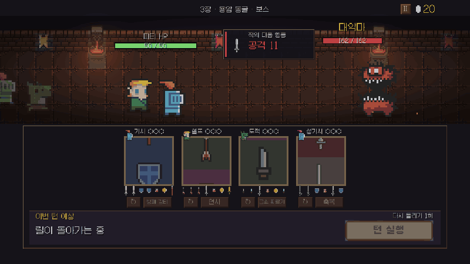
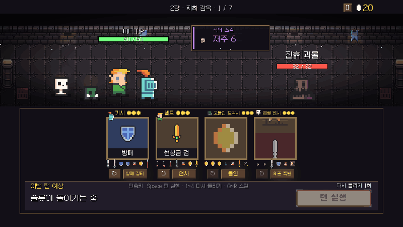
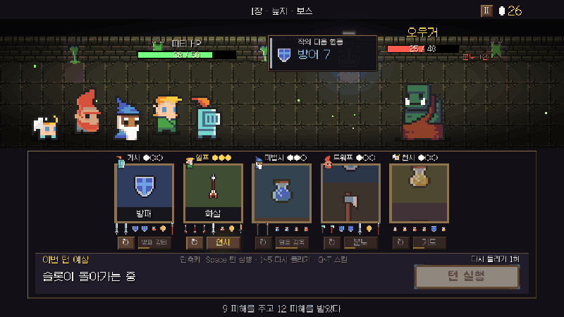
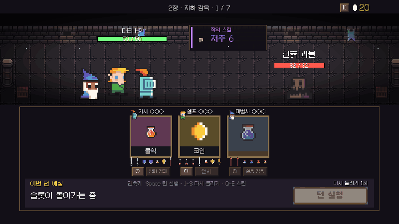
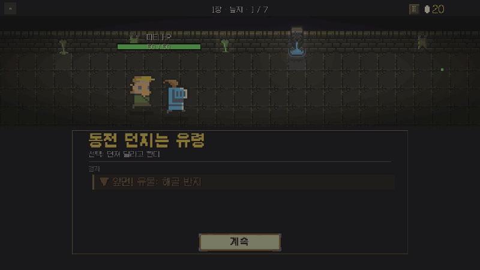
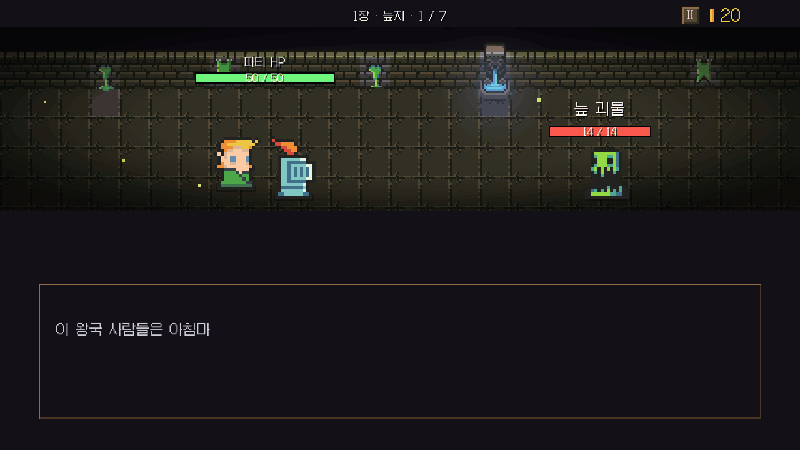
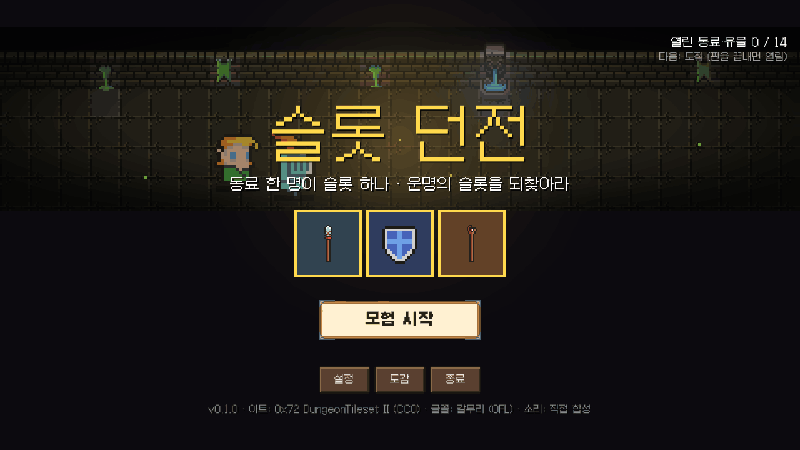
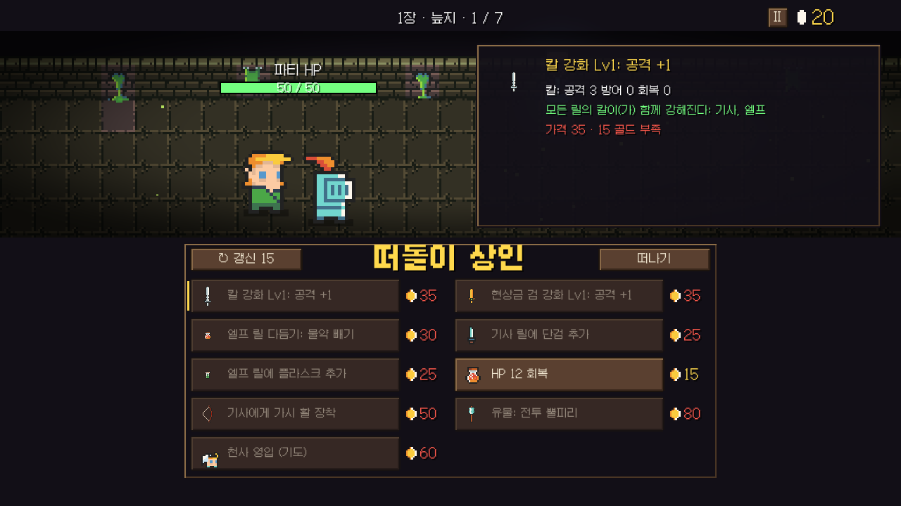
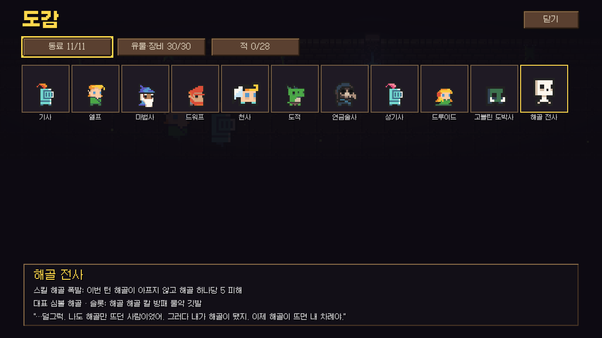
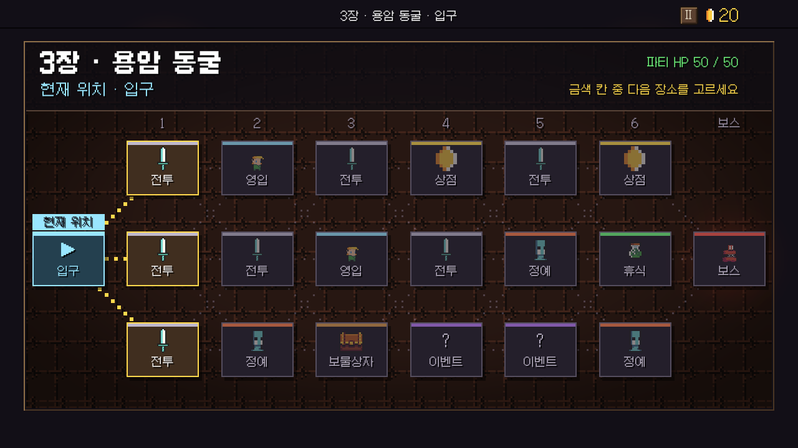

# 슬롯 던전 (Slot Dungeon)

**동료 한 명 = 슬롯머신 한 줄.** 매 턴 슬롯이 돌고, 뜬 그림이 그 턴의 행동이 된다. 칼이 뜨면 베고, 방패가 뜨면 막고, 해골이 뜨면 아프다. 동료를 모을수록 슬롯이 늘고, 싸움에서 이길 때마다 슬롯에 심볼을 넣거나 빼서 나만의 슬롯머신을 만든다. 턴제 던전 로그라이크.



| | |
|---|---|
|  |  |
| 동료 스킬 — 게이지가 차면 Q~Y로 건다 | 보스는 체력 절반에서 2단계로 바뀐다 |
|  |  |
| 적도 스킬을 쓴다 — 저주, 슬롯 고장, 마력 흡수… | 이벤트 선택의 결과가 한 줄씩 뜬다 |
|  |  |
| 동료마다 합류 대사와 보스 앞 한마디 | 타이틀 · 도감 · 해금 진행도 |

## 이야기

이 왕국 사람들은 아침마다 광장의 **운명의 슬롯**을 한 번씩 돌린다. 칼이 뜨면 일이 잘 풀리고, 물약이 뜨면 병이 낫는다. 그런데 대악마가 슬롯을 던전 깊은 곳으로 가져간 뒤로 누가 돌려도 해골만 뜬다. 동생 약이 급한 기사는 엘프와 함께 던전으로 내려간다.

늪에 뒤집힌 **왕실 수레**, 감옥에 걸린 **해골 명부**, 용암 동굴 끝에서 슬롯을 쥔 대악마. 따라 내려갈수록 누가 누구의 불운을 떠넘겼는지가 드러난다. 동료 11명은 저마다 합류 이유가 있고, 보스 앞에서는 파티에 있는 동료가 한마디씩 한다. 대사는 `Assets/Resources/story.json`.

## 어떻게 노나

1. **지도** — 장마다 갈림길 7칸. 전투·정예·영입·상점·이벤트(?)·보물상자(가끔 미믹)·휴식 중 다음 칸을 고른다. 칸 종류마다 색이 다르다.
2. **전투** — 슬롯이 자동으로 돈다. 마음에 안 드는 슬롯 하나를 다시 돌리고(턴당 1번), 게이지가 찬 스킬을 걸고, **턴 실행**.
   - 서로 다른 슬롯에 같은 심볼 2개면 1.5배, 3개 이상이면 2배 (**콤보**).
   - 적은 다음 행동을 미리 보여준다. 체력바에는 이번 턴에 줄 피해와 받을 피해가 미리 깜박이고, 잡을 수 있으면 "처치!"가 뜬다.
3. **보상·상점** — 심볼 추가·빼기, 심볼 강화(모든 슬롯의 그 심볼이 같이 강해짐), 장비, 유물, 동료 영입. 고른 항목이 어떤 슬롯을 어떻게 바꾸는지 위쪽에 크게 보여준다.
4. **보스** — 늪지 오우거 → 지하 감옥 거대 좀비 → 용암 동굴 대악마. 체력 절반 아래로 떨어지면 2단계(광폭화 / 썩은 피의 굶주림 / 지옥불 각성)로 바뀐다.

**단축키**: Space/Enter 턴 실행 · 숫자 1~6 그 슬롯 다시 돌리기 · Q W E R T Y 그 동료 스킬 · 보상 화면에서 숫자로 고르기 · Esc 일시정지

## 들어 있는 것

| | 수 | 예시 |
|---|---|---|
| 동료 | 11명 | 기사(방패 강타), 엘프(연사), 마법사(얼음 감옥), 도적(독·급소 찌르기), 고블린 도박사(올인: 골드 절반을 걸고 그만큼 피해), 해골 전사(해골 폭발: 해골이 무기가 된다) |
| 심볼 | 17종 + 해골 | 칼·방패·물약·코인·단검(독)·얼음(약화)… **깃발**(양옆 슬롯 +2), **쌍검**(옆에도 쌍검이면 각자 +4) — 파티 순서가 곧 슬롯 순서 |
| 적 | 28종 | 장마다 일반 6·정예 2~3·보스 1, 미믹. 같은 그림도 색으로 구분 |
| 적 행동 | 11종 | 공격·방어·저주·분노·흡혈·강탈(골드)·봉인(다시 돌리기 금지)·재생·슬롯 고장·마력 흡수(게이지 비우기)·가시 갑피(피해 반사) |
| 유물 / 장비 | 16 / 14 | 피의 성배(흡혈), 해골 왕관(해골이 적을 때림), 콤보 메달, 도박꾼의 주사위… |
| 이벤트 | 22종 | 비뚤어진 거울(내 파티의 거울상과 싸움), 보스의 그림자, 동전 던지는 유령, 한밤의 연회(HP 전부 회복 vs 골드 전부), 황금 분수, 슬롯 융합로… |

- **해금**: 동료 6명과 유물 8개는 처음엔 잠겨 있다. 판을 끝낼 때마다 1개(이기면 2개)씩 열린다. 힘이 아니라 선택지가 늘어나는 해금.
- **도감**: 타이틀의 "도감". 동료·유물·장비·적. 잠긴 것은 실루엣이고, 적은 한 번 만나면 기록된다. 스킬, 슬롯 구성, 적 행동 순서와 2단계까지 볼 수 있다.
- **어려움 0~5**: 클리어하면 다음 단계가 열린다 (적 체력 +10% → 휴식 절반 → 가격 +20% → 적 공격 +1 → 시작 골드 0·보스 체력 +15%).
- **이어하기**: 화면이 바뀔 때마다 자동 저장. 전투 중에 꺼도 같은 적·HP·슬롯 그대로 이어진다.





## 만든 것들

- 엔진: Unity 6000.6.9f1 (Unity 6), C#. 화면은 IMGUI와 코드로 그린 픽셀 패널, 1280×720 기준 균일 확대
- 아트: [0x72 DungeonTileset II](https://0x72.itch.io/dungeontileset-ii), Kenney Pixel UI 버튼 (둘 다 CC0). 유물 아이콘 일부(`tools/make_item_icons.py`)와 앱 아이콘(`tools/make_icon.py`)은 직접 그림
- 글꼴: 갈무리 Galmuri (SIL OFL 1.1)
- 소리: 효과음 19개와 음악 2곡을 `tools/gen_audio.py`로 합성
- 수치와 콘텐츠는 전부 `Assets/Resources/tuning.json` — 심볼·동료·적·유물·이벤트·가격·지도·해금 순서

## 밸런스

자동 플레이 봇이 난이도마다 2,000판씩 돌려 승률과 판이 끝나는 곳을 본다 (해금은 전부 열린 상태, 이벤트는 고르지 않음).

| 난이도 | 보통 | 1 | 3 | 5 |
|---|---|---|---|---|
| 봇 승률 (2026-11-19) | 43.5% | 30.3% | 23.1% | 6.1% |

보통 기준 보스 도착 평균 HP는 1장 78%, 2장 85%, 3장 83%. 가장 많이 지는 곳은 대악마, 거대 좀비, 오우거 순.

## 실행

```bash
U="/Applications/Unity/Hub/Editor/6000.6.9f1/Unity.app/Contents/MacOS/Unity"
"$U" -batchmode -projectPath "$PWD" -runTests -testPlatform EditMode -testResults /tmp/results.xml   # 테스트 82개
"$U" -batchmode -quit -projectPath "$PWD" -executeMethod BuildScript.BuildMac                     # → Builds/Mac/ReelDungeon.app
open Builds/Mac/ReelDungeon.app
"$U" -batchmode -quit -projectPath "$PWD" -executeMethod BalanceSim.Run -simRuns 2000 -logFile - | grep "\[sim\]"
bash tools/make_gifs.sh   # README GIF 다시 찍기 (빌드 후, ffmpeg 필요)
```

에디터에서 열 때는 Unity Hub → Add → 이 폴더. 저장 위치 `~/Library/Application Support/GG/Reel Dungeon/run.json`.

스크린샷·GIF용 실행 옵션: `--screenshot <절대경로> --at <초> [--capture-frames N]`과 함께 `--title`, `--chapter N`, `--node <Combat|Elite|Shop|Event|Treasure|Recruit|Rest|Boss>`, `--enemy <적 이름>`, `--event <id> --pick N`, `--recruit a,b`, `--equip`, `--relic`, `--charge`, `--autocommit`, `--autoturns N`, `--nostory`, `--notips`, `--unlockall`, `--unlocks N`, `--codex --codextab 0~2 --codexpick N`, `--pause`, `--settings`. 스크린샷 실행은 저장·해금·도감 기록을 건드리지 않는다.

> 이름: 2026-11-19에 "릴 던전"에서 "슬롯 던전"으로 바꿨다. 폴더(`reel-dungeon`), 코드 이름(`ReelDungeon`), 앱 파일 이름과 저장 위치(`Reel Dungeon`)는 기존 저장을 잃지 않도록 그대로 둔다. 다른 에이전트 인계는 `HANDOFF.md`.
