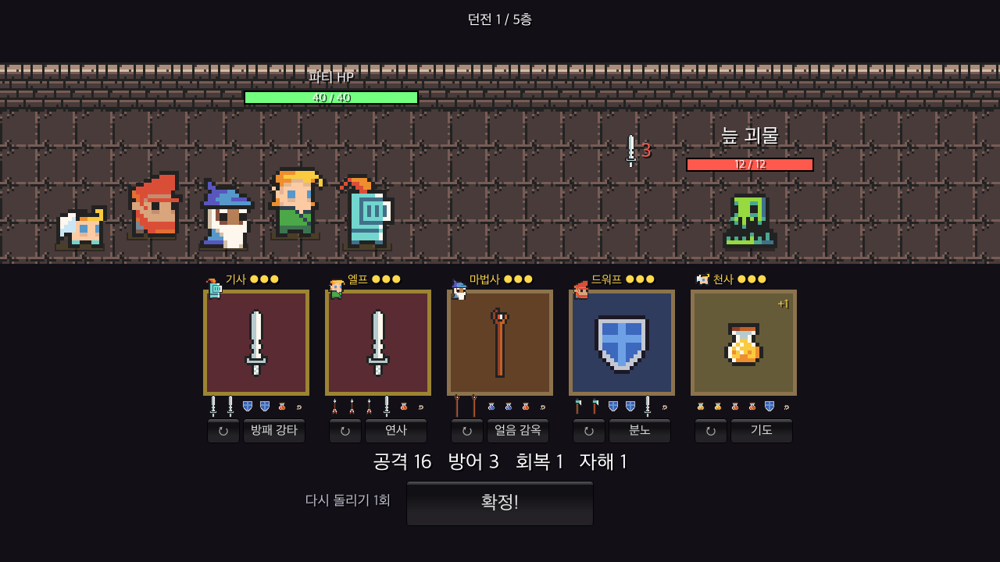
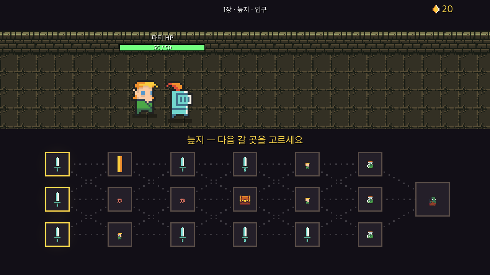
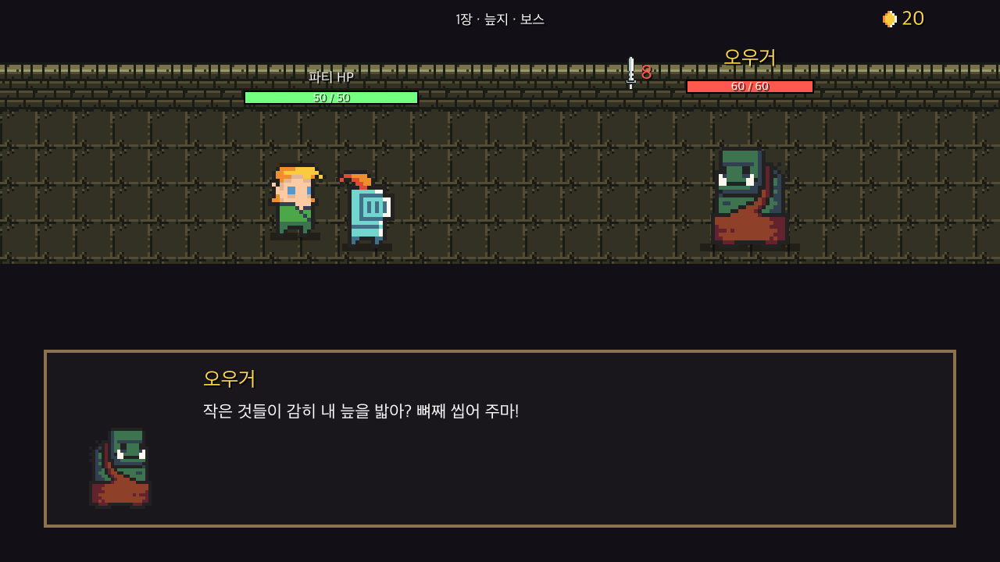

# 릴 던전 (Reel Dungeon)

동료 한 명이 릴 하나. 슬롯을 돌려 나온 심볼이 그 턴의 행동이 되는 턴제 던전 로그라이크. 동료를 모을수록 릴이 늘고, 적을 이길 때마다 릴에 심볼을 넣거나 빼며 나만의 슬롯을 만든다.




- 엔진: Unity 6000.6.9f1 (Unity 6), C#
- 상태: 프로토타입. IMGUI로 그림. 캐릭터·타일은 0x72 DungeonTileset II (CC0), 방패 아이콘은 자체 제작.

## 이야기

땅 밑의 대악마가 세상의 운을 정하는 '운명의 릴'을 훔쳐 갔다. 기사는 부서진 릴 조각에 동료들의 힘을 엮어 던전으로 내려간다. 프롤로그, 장 도입, 보스 대사, 동료 합류 대사, 엔딩은 `Assets/Resources/story.json`.



## 규칙 (v3)

- 장비: 동료마다 한 칸. 그 동료 릴에 특정 심볼이 뜨면 효과 (예: 기사의 장검 = 칼 공격 +2). 정예·미믹·보물상자·상점·보스에서 얻는다.
- 유물: 파티 전체 패시브 (행운의 동전, 해골 반지, 모래시계, 거인의 심장, 전투 뿔피리, 숫돌, 성수). 보스·이벤트·상점에서 얻는다.
- 이벤트 "?" 칸: 피 묻은 제단, 짐을 잃은 상인, 검게 물든 샘, 무너진 예배당, 잠든 모험가, 도박꾼 고블린.

- 3장 구성: 늪지 → 지하 감옥 → 용암 동굴. 장마다 갈림길 지도(7칸)를 지나 보스(오우거 → 거대 좀비 → 대악마)를 잡는다.
- 지도 칸: 전투, 정예, 영입, 상점, 휴식(보스 직전 줄), 보물상자(가끔 미믹).
- 골드: 코인 심볼과 처치 보상으로 모아 상점에서 쓴다. 심볼 강화(모든 릴의 그 심볼 +1, 레벨마다 비싸짐), 릴 다듬기(약한 심볼 빼기), 상점 갱신(할 때마다 비싸짐), 심볼·해골 제거·회복·장비·유물·동료.
- 기사 + 엘프로 시작. 영입 칸·상점에서 동료를 모은다 (최대 5명 = 릴 5개).
- 동료마다 자기 릴과 스킬이 있다: 기사 방패 강타, 엘프 연사, 마법사 얼음 감옥, 드워프 분노, 천사 기도.
- 동료의 대표 심볼이 뜨면 스킬 게이지 +1. 3칸이 차면 스킬 버튼으로 이번 턴에 건다.
- 릴은 매 턴 자동으로 돈다. 턴마다 릴 하나를 1번 다시 돌릴 수 있다.
- 서로 다른 릴에서 같은 심볼 2개면 1.5배, 3개 이상이면 2배. 해골 = 저주(자해).
- 적은 다음 행동을 미리 보여준다: 공격, 방어(이번 턴 받는 피해 감소), 저주(이 전투 동안 릴에 해골), 분노(이후 공격 강화), 흡혈(막지 못한 만큼 회복).
- 보스 직전 줄에는 휴식이 한 칸뿐이라, 가는 길에 얼마나 맞았는지가 보스전에 이어진다.
- 동료마다 공격 모션이 다르다: 기사 베기, 엘프 화살, 마법사 마법탄, 드워프 내려찍기, 천사 빛줄기.
- 수치는 전부 `Assets/Resources/tuning.json`.

## 소리

효과음 19개와 배경음악 2곡(던전, 보스)은 `tools/gen_audio.py`가 합성한다 (`python3 tools/gen_audio.py`, numpy 필요).

## 밸런스

자동 플레이 봇이 수백 판을 돌려 승률과 판이 끝나는 지점을 보여준다.

```bash
"$U" -batchmode -quit -projectPath "$PWD" -executeMethod BalanceSim.Run -simRuns 1000 -logFile - | grep "\[sim\]"
```

2026-11-18 기준 (2000판) 봇 승률 40.8%. 보스 도착 시 HP: 1장 69%, 2장 82%, 3장 87%. 번 골드의 63%를 쓰고 판당 강화 1.6회. 일반 전투·정예·미믹에서도 판이 끝난다.

## 실행

```bash
U="/Applications/Unity/Hub/Editor/6000.6.9f1/Unity.app/Contents/MacOS/Unity"
"$U" -batchmode -projectPath "$PWD" -runTests -testPlatform EditMode -testResults /tmp/results.xml
"$U" -batchmode -quit -projectPath "$PWD" -executeMethod BuildScript.BuildMac
open Builds/Mac/ReelDungeon.app
```

에디터에서 열 때는 Unity Hub → Add → 이 폴더.
