# 가라앉은 도시

물에 잠긴 고대 도시를 잠수해 탐사하고, 펌프를 고쳐 물을 빼면 그 구역이 마을이 되는 2D 탐험·재건 게임.

**상태:** 🚧 개발 진행 중 — 보류 (2026-11-06). 플레이해 보니 재미가 부족해서 멈춤. 다시 잡을 때는 "왜 재미없나"부터 — 낮 잠수 / 밤 가게 루프(`design/research-dave-like.md` 4절)가 후보.

M3 일부까지 — 펌프 밸브(물 채우기·빼기), 기둥 위 톱니, 마른 층 게. 그 이전: M2 플레이 가능 — 잠수·펌프 수리로 물 빼기(M1) → 마른 땅에 공방·숙소·조명탑 짓기, 장비 업그레이드, 주민 부탁, 단단한 벽 너머 깊은 구역과 수압, 맨 아래 봉인된 수문(M2 끝). 그림은 GPT 묶음 1·2 적용됨

<p align="center">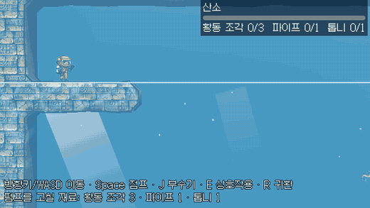<br><sub>수면에서 잠수해 가라앉은 유적으로</sub></p>

## 이런 게임

- **잠수 탐사** — 산소를 관리하며 헤엄치고, 잔해를 부숴 황동 조각·파이프·톱니를 모으기
- **물 빼기** — 펌프를 고치면 구역의 물이 빠지고 걸어 다닐 수 있게 됨. 밸브로 다시 채우기도
- **마을 재건** — 마른 땅에 공방·숙소·조명탑을 짓고 주민 부탁 들어주기
- **더 깊이** — 수압이 센 깊은 구역, 게·장어, 맨 아래 봉인된 수문

## 플레이 화면

**바다**

| | | |
|---|---|---|
| 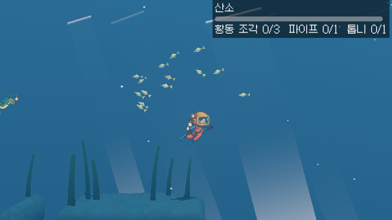 | 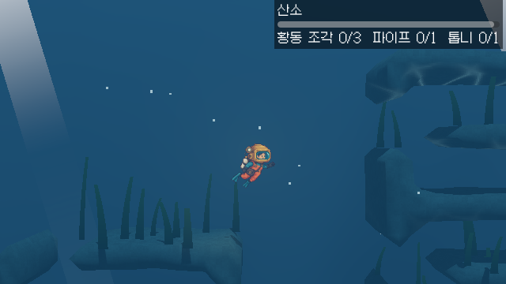 | 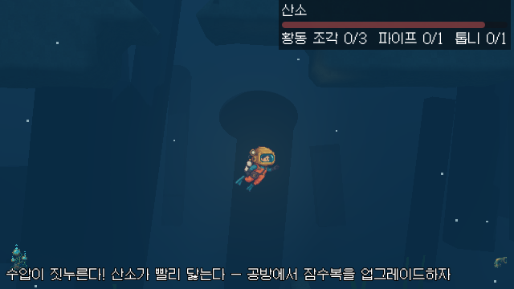 |
| 물고기 떼가 지나가는 바다 | 해초 사이 가라앉은 탑 | 깊은 유적 |

**탐사**

| | | |
|---|---|---|
| 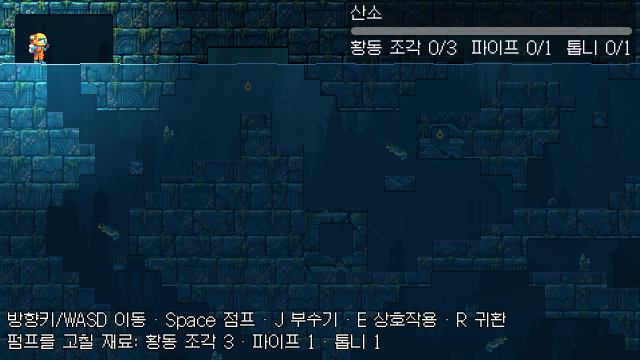 | 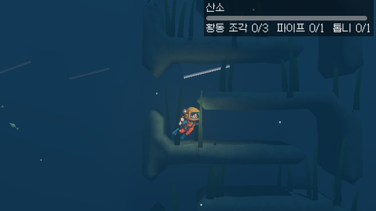 | 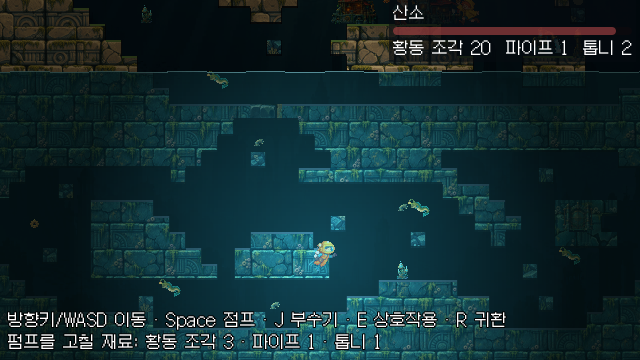 |
| 출발점 — 수몰된 탑 | 탑 안 | 수압이 센 깊은 구역 |

**마을**

| | | |
|---|---|---|
| 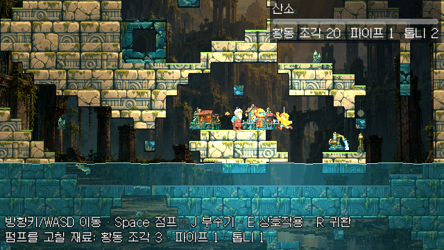 | 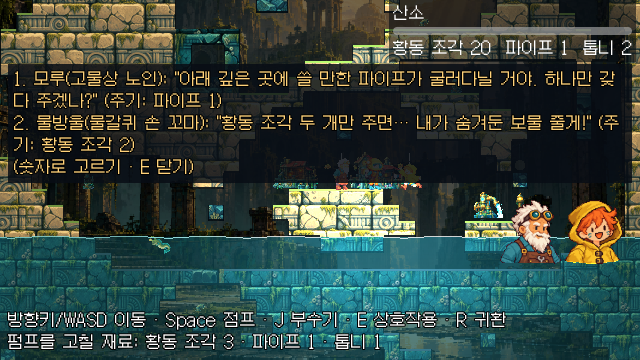 | 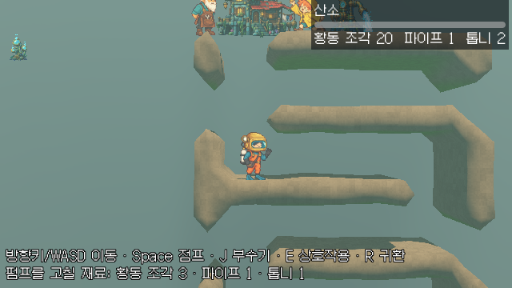 |
| 물을 뺀 구역의 마을 | 숙소 주민들의 부탁 | 수면 위 마을 |

**밸브**

| | | |
|---|---|---|
| 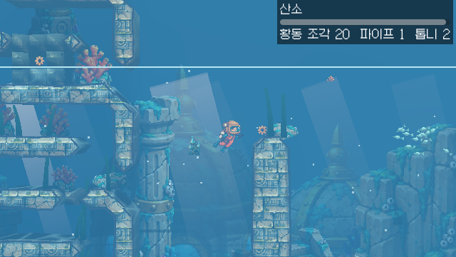 | 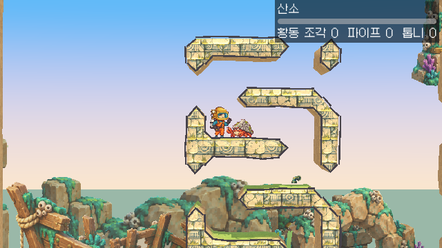 | 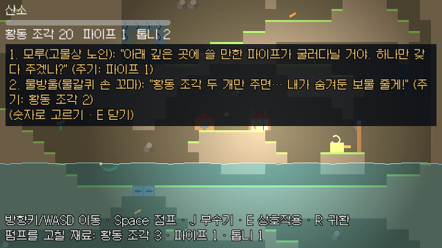 |
| 물을 다시 채워 닿는 기둥 | 마른 층의 돌 껍데기 게 | 숙소 메뉴 |

**하늘과 물**

| | | |
|---|---|---|
| 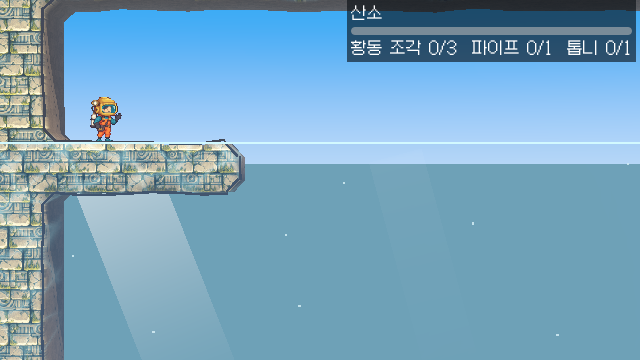 | 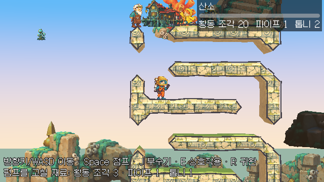 | 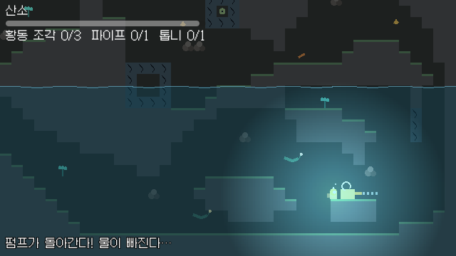 |
| 수면 위 출발점 | 하늘 위로 쌓인 마을 | 펌프를 고치면 물이 빠진다 |

## 실행
```bash
godot --path sunken-city
```
| 키 | 동작 |
|---|---|
| 방향키 / WASD | 이동 (물속은 헤엄, 마른 땅은 걷기) |
| Space | 점프 (수면 가까이서 누르면 물 밖으로) |
| J / X | 바라보는 칸 부수기 (금 간 벽 2번, 잔해 1번 → 황동 조각) |
| E | 펌프 수리 (황동 조각 3 · 파이프 1 · 톱니 1) / 고친 펌프는 밸브: 물 다시 채우기·빼기 / 빈터에서 건물 짓기 / 공방·숙소 메뉴 |
| 1 2 3 | 메뉴 고르기 |
| R | 출발점(물 빼기 전) 또는 마을(뺀 뒤)로 귀환 |

산소는 물속에서 줄고 공기 식물·물 밖에서 다시 참. 다 떨어지면 출발점(물 뺀 뒤엔 마을)에서 깨어나고 황동 조각 절반을 잃음. 부순 잔해는 60초 뒤 다시 쌓임.

**M3 (시작):** 고친 펌프에서 E → 물을 지붕 바로 아래까지 다시 채우거나 뺌. 바다 가운데 외딴 기둥 위 톱니는 물을 채워야만 헤엄쳐 닿음. 물을 빼면 탑 안 마른 층에 돌 껍데기 게가 나와 돌아다님 — 닿으면 황동 조각 1개를 잃음. 물을 채우면 다시 모래 속으로.

**M2 진행:** 공방(조각 2) → 곡괭이(조각 2·톱니 1)로 웅덩이 바닥의 단단한 벽을 뚫음 → 잠수복(조각 3·파이프 1) 없이 깊은 물에 가면 산소가 4배 빨리 닳음 → 맨 아래 봉인된 수문 발견. 숙소(조각 3)엔 주민 모루·물방울, 조명탑(조각 2·파이프 1)은 랜턴 빛을 넓힘.

테스트: `godot --headless --path sunken-city -s res://tests/smoke/run_check.gd` → `PASS`

| 문서 | 내용 |
|---|---|
| [`design/game-brief.md`](design/game-brief.md) | 기획서 — 루프, 마일스톤 M1~M6 |
| [`art/PROMPTS.md`](art/PROMPTS.md) | 이미지 인계 — GPT·Gemini 프롬프트(묶음 1·2), 파일명, 저장 위치 |

## 그림 넣는 법
1. [`art/PROMPTS.md`](art/PROMPTS.md)의 다음 묶음을 GPT(또는 Gemini)로 생성
2. 파일명 그대로 `art/raw/<폴더>/`에 저장
3. `python3 tools/art_build.py` → `assets/`에 게임 크기로 저장 (Claude에게 "이미지 넣었어"라고 하면 연결까지 해줌)
